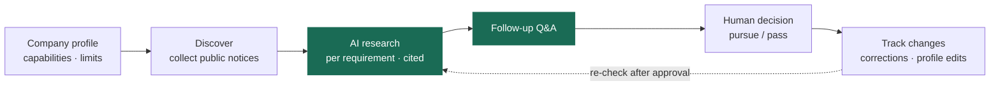
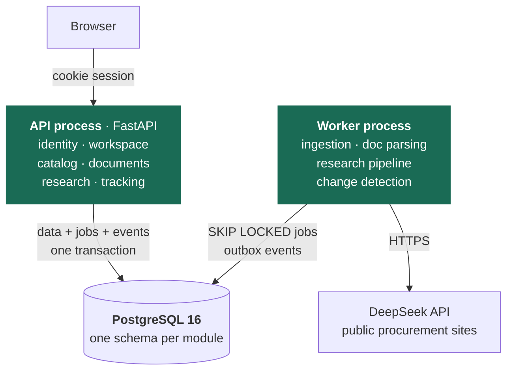
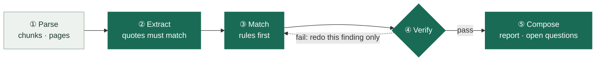

<div align="center">


# BidRadar

**An evidence-first research agent for public tenders**

Helps software companies and AI service teams read Chinese public procurement notices:<br>
what a project requires, whether we can deliver it, and what is still unknown — every finding cites the source text.

[](https://github.com/chasen2041maker/BidRadar/actions/workflows/tests.yml)


[](https://github.com/astral-sh/uv)
[](https://github.com/astral-sh/ruff)
[](#roadmap)

[简体中文](README.md) · **English**

[Quick start](#quick-start) · [Highlights](#highlights) · [Architecture](#architecture) · [Research pipeline](#research-pipeline) · [Roadmap](#roadmap) · [Docs](#docs)

</div>

<br>

<p align="center">
  
</p>

> [!NOTE]
> **v2 rewrite in progress.** The legacy version (`services/`) runs end to end; v2 (`bidradar/`) is a modular monolith on FastAPI + PostgreSQL.
> Stage 0 (foundation) shipped on 2026-10-13. **Next up: stage 1, identity and workspaces.** See the [roadmap](#roadmap).

> The UI and most project docs are in Chinese, since the product targets the Chinese public procurement market.

## Why

A software company bidding on government or state-owned-enterprise projects has to scan many tender notices every day, then check qualifications, technical requirements, delivery terms and budget line by line. It is slow, and the two costly mistakes are treating "unclear" as "met" and misreading a sentence of the source text.

BidRadar breaks the work into verifiable steps and holds one rule: **no finding is published without source text behind it.**



**Non-goals:** BidRadar does not predict win rates, does not bid or quote automatically, and never contacts buyers. Whether to pursue a project is always a human decision.

## Highlights

| | How |
| --- | --- |
| **Evidence first** | Every finding must cite source text. Five statuses: met, unmet, unknown, conflicting, not applicable. **Unknown is never treated as met.** Company profiles are self-declared and unverified, so qualification requirements are always unknown |
| **Code + model verification** | Code checks citations, money roles and where every number comes from; a separate model call then checks that each finding is actually supported by its citation. Failures are revised; if they still fail, a conservative quote-only report is published |
| **Budgeted LLM calls** | Cost is reserved before each call and settled on actual usage. Three caps: ¥20 per round, ¥10 per company, ¥1 per task. An uncertain result (e.g. network drop) is never counted as zero and never retried automatically |
| **Crash-safe** | Requests are persisted before sending and responses are booked before use, so a crash at any point resumes without paying twice. Workers hold a lease with an increasing epoch; a stale worker cannot write |
| **Frozen inputs** | Notice versions, profile versions and reports are insert-only. New material produces a new report; an old report always knows which inputs it was built from |
| **External content is data** | Web pages, attachments and model output are never executed as instructions. Research tools can only read the frozen material of the current task; the model never sees URLs, SQL or file paths |
| **Layering enforced by CI** | Six import-linter contracts: `models.py` has no framework imports, modules talk only through each other's `service`, `agent/` is pure logic |

## Screenshots

<table>
  <tr>
    <td width="50%"></td>
    <td width="50%"></td>
  </tr>
  <tr>
    <td align="center"><sub>Notice and evidence: every field traces back to the source</sub></td>
    <td align="center"><sub>Company profile: members propose, admins confirm, every version is kept</sub></td>
  </tr>
</table>

<sub>All companies and notices in the screenshots are fictional demo data.</sub>

## Architecture

v2 is a **modular monolith**: one codebase, an API process and a worker process, and seven business modules that each own a PostgreSQL schema. Get the boundaries right first; once they are clear, splitting into services is routine work.



Three rules keep a future split cheap:

1. **Own your data.** A module reads and writes only its own schema. Splitting means moving that schema.
2. **Public entry points only.** Modules call each other only through functions in `service.py`. Splitting means swapping in an HTTP client with the same interface.
3. **Async through events.** Asynchronous work goes through an outbox table. Splitting means pointing the outbox at Redis Streams or RabbitMQ.

Inside every module the layers are `api → schemas → service → repo → tables → models`; upper layers may depend on lower ones, never the reverse.

| Concern | Choice | Why |
| --- | --- | --- |
| Web | FastAPI + Pydantic v2 | Routing, validation and API docs out of the box; no hand-written HTTP layer |
| Data | PostgreSQL 16 · SQLAlchemy 2 · Alembic | Transactions, row locks, JSONB, row-level security (RLS), `SKIP LOCKED` queues |
| Background jobs | PostgreSQL job table + leases | One less component; a job and its business data commit in the same transaction |
| LLM | Own `LLMClient` interface, DeepSeek as one implementation | No framework lock-in; changing models means changing one class |
| Tooling | Python 3.12 · uv · ruff · pytest · import-linter · GitHub Actions | Mainstream, reproducible, rules enforced by CI |

<details>
<summary>Legacy architecture (<code>services/</code>, removed in v2 stage 6)</summary>

<br>

Four local HTTP services — workspace (:8965, the browser entry point), catalog (:8966), research (:8967) and tracking (:8968) — each with its own SQLite database, talking over loopback HTTP with service tokens. Ingestion and normalization are two command-line pipelines. The whole thing uses only the Python standard library.

See [architecture.md](docs/architecture.md) (Chinese).

</details>

## Research pipeline

The legacy agent asked one model call to read the material, find requirements, compare them with the company, write reasons and write a summary. With that much in one call it made mistakes, and the fix was always another patch rule in the prompt. v2 splits the work into five small steps: **anything code can decide stays in code; when the model is needed, it gets one small question at a time.**



<sub>Dark: steps that may call the model (③ only when rules cannot decide, ④ after code checks, ⑤ only for the summary). Light: pure code. A failed finding is retried at most twice; after that it becomes "unknown" and is flagged.</sub>

- **Every step is persisted.** After a worker crash, finished steps are reused.
- **Only the failing finding is redone.** The legacy agent had to rewrite the whole report.
- **Extract once, share across companies.** The same public tender file with the same extractor version is extracted once — cheaper, and measurable on its own.
- **Follow-up Q&A is the only tool loop.** It is the one place where the model must decide what to look up next, capped at 6 model calls and 12 tool calls.

<details>
<summary>An example: why split the work</summary>

<br>

A tender says "complete system development within 60 days of signing". The company profile says "no continuous on-site work longer than 30 days".

The legacy agent once read the first sentence as "60 days on site", and the prompt gained a patch rule: "a 60-day development deadline is not on-site work".

In v2, step ② files the requirement under *delivery*. In step ③, delivery requirements are compared only with fields such as schedule and team size; the on-site limit belongs to another dimension and is never compared. The result is "unknown: the profile has no schedule or staffing plan", which goes to the open-questions list. No patch rule needed.

</details>

### Results so far

The legacy agent was tested on 2026-10-01 with 2 real notices × 2 fictional companies (DeepSeek V4 Flash):

| Metric | Result |
| --- | --- |
| Real tasks / model calls | 39 tasks · 212 calls |
| Total cost | about ¥4.48 (at peak pricing) |
| Final samples | all 5 passed an independent AI review |
| vs. rule baseline | The agent caught a capability gap the baseline missed, but skipped one requirement group the baseline listed |
| Critical errors | Neither side turned an "unknown" qualification into met or unmet |

The sample is too small to **say anything about accuracy**. That is why v2 treats evaluation as a first-class part of the project: 30 cases (at least 10 labeled by hand), a one-third holdout set, and a full evaluation run with before/after numbers in every PR that touches prompts or rules. See [agent.md](docs/agent.md) (Chinese).

## Roadmap

### Direction

| Track | From | To |
| --- | --- | --- |
| **Architecture** | Four services + loopback HTTP + hand-written HTTP layer | Modular monolith (FastAPI + PostgreSQL); split the worker side first once boundaries are proven |
| **Research quality** | One large call + patched prompts | Five-step pipeline driven by evaluation; every step unit-tested and measured on its own |
| **Data source** | Notice excerpts only; qualifications and scoring mostly missing | Uploaded tender documents as the main input; public collection is for discovery ([ADR 0010](docs/decisions/0010-upload-first-direct-analysis.md)) |

### Stages

New code lives in `bidradar/`; the legacy `services/` keeps working until stage 6. Every stage ends with a project that runs and passes its tests.

| Stage | Scope | Done when | Status |
| --- | --- | --- | --- |
| **0 Foundation** | uv project, FastAPI skeleton, PostgreSQL, Alembic, import-linter, CI | `GET /health` works, CI green | Done · Oct 13 · [#14](https://github.com/chasen2041maker/BidRadar/pull/14) |
| **1 Identity & workspaces** | Login, three roles, profile versions, row-level security (RLS) | Two companies cannot see each other's data | **Next** |
| 2 Catalog & ingestion | Port the catalog and the CCGP / Hainan adapters | The 12 real notices import and are searchable | Planned |
| 3 Documents | Upload PDF / Word, parse, chunk, search | A real tender file shows chunks with page numbers | Planned |
| 4 Research pipeline | Five steps, job queue, budget ledger, eval v0 | Evals report metrics; a killed worker resumes without double charging | Planned |
| 5 Follow-up & tracking | Q&A agent, decisions, watches, notifications, outbox | Each change notifies once; approved re-checks run automatically | Planned |
| 6 Wrap-up | Frontend on the new API, delete `services/`, 30 eval cases | All tests and evals pass with the legacy code gone | Planned |

### Next: stage 1, identity and workspaces

- [ ] **Login** (reference example): API, service, repo, tables, migration and tests end to end, as the template for similar features
- [ ] **Logout, member management, profile proposals and confirmation**: built from the example
- [ ] **Row-level security (RLS)**: set `app.workspace_id` at the start of every transaction as a second line of tenant isolation
- [ ] **Acceptance**: a test proves two companies cannot see each other's data; the legacy workbench's login and profile features work on the new API

### Later (only with a clear reason)

Split services (worker side first) · Redis caching and rate limiting · Kubernetes · cloud deployment · OCR for scanned files · Chinese tokenization or vector search

### Not done yet

Production user system · cloud deployment · continuous crawling · real user trials · hand-labeled evaluation set

Full plan: [v2 blueprint](docs/v2-blueprint.md). Progress: [roadmap.md](docs/roadmap.md) (both Chinese).

## Quick start

### Try the full flow (legacy, zero dependencies)

Needs Python 3.10+ and nothing else.

```bash
git clone https://github.com/chasen2041maker/BidRadar.git && cd BidRadar
python scripts/run_research_workbench.py      # start the four services; no real model calls by default
```

Open <http://127.0.0.1:8965/>. Test accounts are in `.bidradar-data/r12-workbench/demo-accounts.json`.

> [!TIP]
> A fresh clone has no real notice samples. In the catalog, switch the data scope (数据范围) to **虚构演示样本** (fictional demo sample) to see the demo notice.

```bash
python -m unittest discover -s tests -p 'test_*.py'          # 486 tests
python scripts/run_data_demo.py                              # offline data pipeline: collect → normalize → catalog
python scripts/run_research_workbench.py --enable-model      # allow DeepSeek calls (costs money)
```

### Develop v2

Needs Python 3.12, [uv](https://docs.astral.sh/uv/) and Docker.

```bash
docker compose up -d --wait db            # start PostgreSQL 16
uv run alembic upgrade head               # run migrations
uv run uvicorn bidradar.app.main:app      # start the API → http://127.0.0.1:8000/health
uv run pytest && uv run lint-imports      # tests + layering rules
```

Settings are listed in [`.env.example`](.env.example); defaults apply when there is no `.env`. More in the [dev guide](docs/dev-guide.md#v2-新代码bidradar) (Chinese).

## Project layout

```text
bidradar/            v2: modular monolith
├── app/             wiring: FastAPI app, settings, dependency injection
├── modules/         identity · workspace · catalog · ingestion · documents · research · tracking
│   └── <module>/    api · schemas · service · repo · tables · models
├── agent/           research pipeline (pure logic, no web or database)
│   ├── steps/       parse · extract · match · verify · compose
│   └── prompts/     one versioned prompt file per step
└── infra/           database sessions, job queue, outbox
migrations/          Alembic migrations
tests_v2/            v2 tests (pytest against real PostgreSQL)
services/            legacy services (removed in stage 6)
scripts/             launch, demo and evaluation scripts
tests/               legacy tests (unittest)
docs/                documentation and decision records
```

## Docs

All documents below are in Chinese.

| Document | Contents |
| --- | --- |
| [v2 blueprint](docs/v2-blueprint.md) | Why the rewrite, the target design, and the stage plan |
| [Roadmap](docs/roadmap.md) | Current progress, known gaps, history |
| [Research agent](docs/agent.md) | How research works, how it is verified and budgeted, test results |
| [Architecture](docs/architecture.md) | How the legacy code is organized and how a request flows |
| [Data model](docs/data-model.md) | Tables and key concepts |
| [Dev guide](docs/dev-guide.md) | Running locally, tests, commit conventions, writing rules |
| [Decision records](docs/decisions/) | 10 architecture decision records (ADRs): context, decision, cost |

## Contributing

- Work on a branch and merge into `main` through a PR. CI runs the legacy tests (Python 3.10 / 3.12), v2 layering checks, migrations, pytest and formatting.
- When code changes, update the related docs and comments. Comments explain *why*, not *what*.
- Three hard lines: no real model calls without the owner's approval; never commit secrets or real company data; never trust identity or roles sent by the browser — re-check permissions before every action.

The full rules are in [AGENTS.md](AGENTS.md); they apply to human contributors and coding agents alike.

<br>

<div align="center">
<sub>All company data is fictional · Notices come from a bounded public sample of the China Government Procurement Network and the Hainan Public Resources Trading Platform</sub>
</div>
