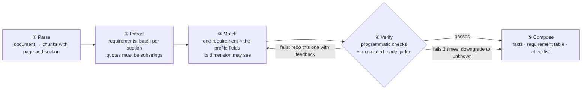
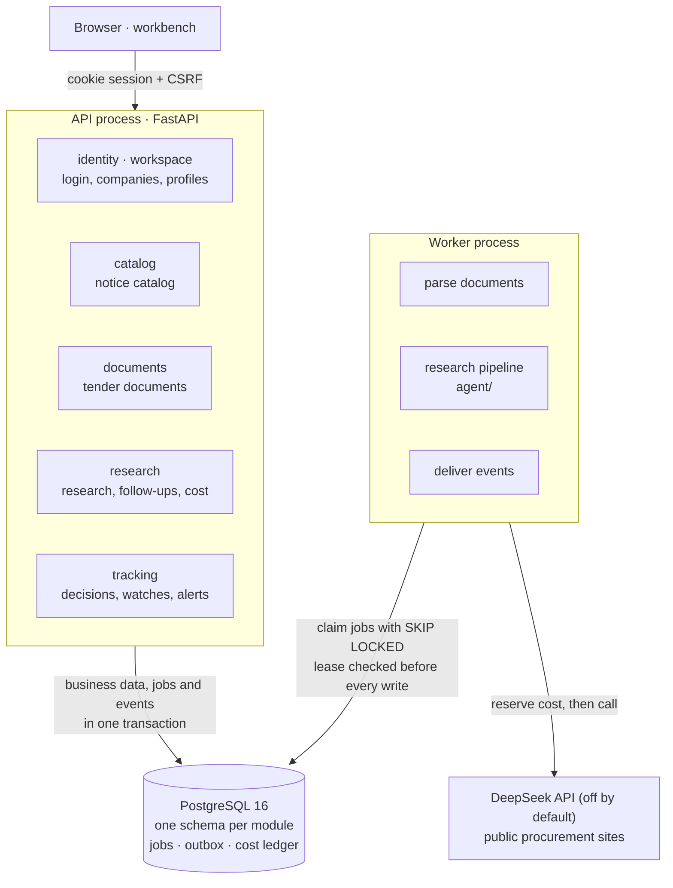

<div align="center">


# BidRadar

**An evidence-first research agent for public tenders**

Helps software and AI service teams read public procurement notices: what is required, whether they can deliver, and what is still missing.<br>
Every conclusion cites the source text. When it cannot tell, it says so.

[](https://github.com/chasen2041maker/BidRadar/actions/workflows/tests.yml)


[简体中文](README.md) · **English**

</div>

> The product, the UI and the code comments are in Chinese: the first market is Chinese government procurement. This page is a translation of the Chinese README.

## The problem

A five-person software shop sees a tender for a "knowledge base platform" on a government procurement site. Whether to bid depends on dozens of requirements scattered across a long tender document:
eligibility, delivery deadline, on-site staffing, private deployment, payment terms, scoring items… Checking them one by one takes half a day, and the one you miss is usually the one that disqualifies you.

BidRadar does three things:

1. **Discover**: public procurement notices become a searchable catalog; fields such as budget and deadline carry their source text.
2. **Research**: upload the tender document; BidRadar lists every requirement and compares it with the company profile as *met / clearly unmet / needs checking*. Each conclusion cites the source passage and the exact profile wording, and the report ends with a checklist of open questions.
3. **Track**: when a watched notice is corrected or the company profile gets a new version, you are notified once; with explicit permission, it re-runs the research.


<sub>The scope and cost are estimated first; a run is created only after you confirm. All companies, notices and documents in the screenshots are fictional.</sub>


<sub>A research report: project facts and the requirement-by-requirement table. This one comes from the rule baseline (no model), so everything it cannot judge is marked "needs checking".</sub>

## Ground rules

1. **Evidence first**: every conclusion cites the source, and quotes must be verbatim. No evidence means "needs checking". Unknown is never treated as met, nor as unmet.
2. **Frozen inputs**: each report is pinned to the notice version, profile version and documents it used. When they change, a new report is made; the old one is kept and marked as having newer inputs.
3. **Every yuan is accounted for**: model calls reserve their cost before they are sent and settle the actual cost afterwards, under three caps (global, per company, per run). When the outcome of a call is unknown, the reservation counts as spent and the run stops for a human; it never retries on its own.
4. **External content is data**: an "ignore the rules above" inside a notice, an attachment or a model reply is never executed. The model gets no URLs, SQL or file paths.
5. **People decide**: no win-probability predictions, no automatic bidding or quoting, no contacting the buyer.

## How research works: a pipeline, not one big agent

Version 1 was a tool-loop agent that read the material, found requirements, compared them with the company and wrote conclusions in a single call. On real notices its mistakes were textbook ones:
reading "finish development within 60 days of signing" as "60 days on site"; using the price ceiling to prove the budget because both were ¥480k; supporting one conclusion with another conclusion's quote.
Each was fixed with one more prompt rule, and a new batch of notices brought new ones.

Version 2 splits research into five fixed steps. Each step gives the model only what it needs for one small question, and programmatic checks keep it honest:



Three structural guarantees replace the ever-growing prompt:

- **Dimension table** (`agent/dimensions.py`): extraction tags each requirement with a dimension, and matching only sees the profile fields that dimension allows. A schedule requirement sees staffing, an on-site requirement sees delivery constraints. Cross-dimension comparisons are impossible because the material is simply not there.
- **Per-finding verification**: each conclusion is verified on its own, without seeing the others. A failure redoes only that one, never the whole report.
- **Programmatic checks** (`agent/checks.py`, free, run on every finding): quotes are substrings of the source; the cited profile wording is a substring of the listed fields; every number in the reasoning appears in the source or the profile; money roles match; no contact details; no claims like "you will win".

Only **follow-up questions** keep a tool loop, because nobody knows in advance which passages a question needs: four read-only tools, at most 6 model calls and 12 tool calls, and the answer must pass citation and number checks or it is replaced by "cannot be confirmed from the material".

Every step's result is stored, so a crashed worker resumes where it stopped; each model call has a stable key, so a resumed run takes the already-paid response from the ledger instead of paying again.
With the model disabled, research runs as a **rule baseline** that never calls a model and works offline. The full design is in [Agent design](docs/agent-design.md) (Chinese).

## Evaluation: find which step went wrong

```bash
uv run python -m evals.run --step extract    # extraction: recall, precision, dimension accuracy
uv run python -m evals.run --step match      # matching, fed with gold requirements so extraction errors do not leak in
uv run python -m evals.run --step verify     # verification: feed it wrong findings, count how many it stops and how many good ones it kills
uv run python -m evals.run --step all        # end to end
```

When a step is evaluated, everything upstream of it uses the gold answers: a requirement missed by extraction should not count as a matching error. Besides the expected status, each gold finding records the mistakes that must never happen (for example, unmet when the truth is unknown); those are counted separately as severe errors.
Model calls are recorded and replayed for free; after a prompt change only the calls that actually changed are sent again.

Current verification results (rule baseline, no model judge):

| Injected error | Stopped |
| --- | --- |
| Concluding from a profile field of another dimension | 36 / 36 |
| Citing "profile wording" that is not in the profile | 36 / 36 |
| Inventing a number in the reasoning | 36 / 36 |
| Real profile wording, but the conclusion is reversed | 0 / 28 — only the model judge can catch these, which is why it exists |

The eval set has only 2 cases so far (one fictional tender × 2 fictional companies). The numbers show that the pipeline works, not how accurate it is.

## Architecture

A modular monolith: one codebase, two processes, one PostgreSQL. Seven business modules each own a schema and call each other only through `service.py`; six layering rules are enforced by import-linter in CI. If it ever needs to become services, it splits along module boundaries.



The full path of a research request and how events become alerts and re-runs are described in [Architecture](docs/architecture.md) (Chinese).

## Quick start

Requires Python 3.12, [uv](https://docs.astral.sh/uv/) and Docker.

```bash
uv sync
docker compose up -d --wait db                 # PostgreSQL 16
uv run alembic upgrade head
uv run python -m bidradar seed-demo            # two fictional companies, four demo accounts
uv run python -m bidradar ingest demo          # offline ingestion with fictional data; note the run_id it prints
uv run python -m bidradar ingest publish <run_id>

uv run python -m bidradar api                  # terminal 1: open http://127.0.0.1:8000/
uv run python -m bidradar worker               # terminal 2: background jobs
```

Demo passwords are in `.bidradar-data/v2/demo-accounts.json`. Sign in as `demo.member`, switch the catalog to "虚构演示样本" (fictional demo samples),
open the notice, upload `tests/fixtures/tender-fictional.pdf`, estimate the cost and confirm.

The model is off by default and research uses the free rule baseline. To use a real model, put a DeepSeek key in `~/.bidradar/credentials/deepseek-api-key.txt`
and set `BIDRADAR_MODEL_ENABLED=true`; estimate the cost on the eval set first (`--llm live --enable-model --max-cost 1`) and then set the per-run cap.

```bash
uv run pytest            # about 500 tests against the bidradar_test database; no network, no real model
uv run lint-imports      # layering rules
```

## Status

Stages 0–6 of v2 are done and the old code has been removed ([roadmap](docs/roadmap.md)). This is a learning project: from the start, the roadmap reserved three core pieces for the project owner to build himself.
They come with interfaces, acceptance tests (skipped by default) and instructions ([exercises](docs/exercises.md)); everything else works:

| Exercise | Current behaviour |
| --- | --- |
| 1. Row-level security | Tenant isolation relies on the first line of defence: every query filters by company. The database-level second line is not there yet |
| 2. Matching step and eval metrics | Matching is a conservative placeholder: every requirement is "needs checking". Extraction, verification, composition and follow-ups work as usual |
| 3. Outbox consumer | Events are written to the outbox but not delivered yet, so change alerts and automatic re-runs do not run |

Other known limits: no OCR for scanned documents; the eval set is small and not yet human-labelled; v2 has not run against a real model yet; ingestion covers limited samples from the China Government Procurement site and the Hainan public resource exchange.

## Layout

```text
bidradar/
  app/        wiring: routes, dependencies, settings, worker, CLI, front end (static/)
  modules/    identity  workspace  catalog  ingestion  documents  research  tracking
  agent/      research pipeline (steps/), follow-up agent, checks, dimension table, prompts (prompts/)
  infra/      database, job queue, outbox, idempotency keys, file storage
evals/        eval cases (YAML), record and replay, per-step runner
migrations/   Alembic migrations
tests/        mirrors bidradar/ by module
docs/         design, architecture, data model, roadmap, decisions
```

## Learn more (in Chinese)

- [Agent design](docs/agent-design.md): what each step shows the model, what is checked, what happens on failure, how it is evaluated
- [Research agent](docs/agent.md): how research works today, and what v1 testing revealed
- [Architecture](docs/architecture.md) · [Data model](docs/data-model.md) · [Developer guide](docs/dev-guide.md)
- [Roadmap](docs/roadmap.md) · [v2 blueprint](docs/v2-blueprint.md) · [Exercises](docs/exercises.md) · [Decisions](docs/decisions/) · [Collaboration rules](AGENTS.md)
