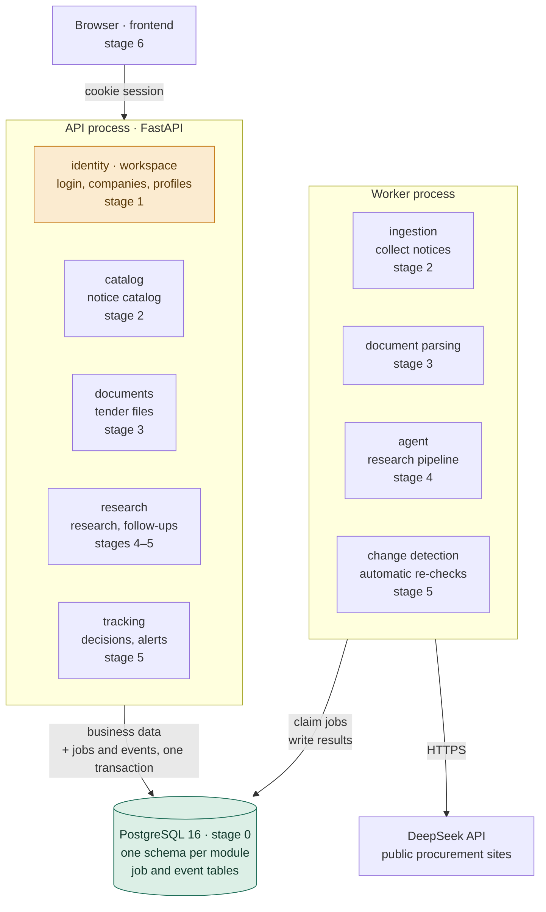

<div align="center">


# BidRadar

**An evidence-first research agent for public tenders**

Helps software and AI service teams read public procurement notices: what a project requires, whether we can deliver it, and what is still unknown.<br>
Every finding cites the source text.

[](https://github.com/chasen2041maker/BidRadar/actions/workflows/tests.yml)


[简体中文](README.md) · **English**

</div>

## Core ideas

1. **Evidence first.** Every finding must cite source text. Anything without support is marked "unknown", and unknown is never treated as met.
2. **Frozen inputs.** Each report is pinned to the notice version and company profile version it was built from. New material produces a new report; old reports never change.
3. **Budgeted model calls.** Cost is reserved before each call and settled afterwards. When a result is uncertain, the task stops for a human instead of retrying.
4. **Humans decide.** No win-rate predictions, no automatic bidding, no contacting buyers. Pursuing or passing on a project is a human decision.

## Plan

The legacy version already runs end to end: company profile → opportunity catalog → AI research → follow-up questions → change tracking. The current work is the **v2 rewrite**, which does three things:

- **Architecture:** merge four services into one modular monolith (FastAPI + PostgreSQL); split services later, once the boundaries are proven.
- **Research:** replace one large model call with a five-step pipeline (parse → extract → match → verify → compose), where every step can be tested and measured on its own.
- **Material:** uploaded tender documents become the main input; public collection is only for discovering projects.

| Stage | Scope | Status |
| --- | --- | --- |
| [0 Foundation](docs/roadmap.md#阶段-0-地基) | Project skeleton, database, migrations, CI | Done |
| [1 Identity & workspaces](docs/roadmap.md#阶段-1-身份与公司) | Login, three roles, company profiles, data isolation (RLS) | **Next** |
| [2 Catalog & ingestion](docs/roadmap.md#阶段-2-商机与采集) | Port the notice catalog and collectors | Planned |
| [3 Documents](docs/roadmap.md#阶段-3-文档与切片) | Upload and parse tender documents (the first background job) | Planned |
| [4 Research pipeline](docs/roadmap.md#阶段-4-研究流水线) | Five steps, cost ledger, evaluation | Planned |
| [5 Follow-up & tracking](docs/roadmap.md#阶段-5-追问与跟踪) | Questions, watches, change alerts, automatic re-checks | Planned |
| [6 Wrap-up](docs/roadmap.md#阶段-6-收尾) | Frontend on the new API, legacy code removed | Planned |

Each stage links to its guide in the roadmap (in Chinese): the tables and APIs to build, the order of work, which part the owner writes, and when the stage is done.

**Further out:** split the worker side first once boundaries are stable; Redis, Kubernetes and cloud deployment only when there is a clear need.

## Architecture

Every box is labelled with the stage that builds it.



<sub>Green: done · Orange: next · Others: planned</sub>

## Screenshot


<sub>All companies and notices in the screenshot are fictional demo data.</sub>

## Quick start

Try the full flow (legacy, Python 3.10+ only):

```bash
python scripts/run_research_workbench.py    # open http://127.0.0.1:8965/
```

Test accounts are in `.bidradar-data/r12-workbench/demo-accounts.json`. In the catalog, switch the data scope to 虚构演示样本 (fictional demo sample) to see the demo notice.

Develop v2 (Python 3.12, [uv](https://docs.astral.sh/uv/) and Docker):

```bash
docker compose up -d --wait db && uv run alembic upgrade head
uv run uvicorn bidradar.app.main:app        # open http://127.0.0.1:8000/health
```

## Learn more

The documents below are in Chinese.

- [Roadmap](docs/roadmap.md): what each stage builds, how to do it, and progress
- [v2 blueprint](docs/v2-blueprint.md): why the rewrite and what it becomes
- [Research agent](docs/agent.md): how research works, and test results
- [Dev guide](docs/dev-guide.md) · [Decision records](docs/decisions/) · [Contributing rules](AGENTS.md)
