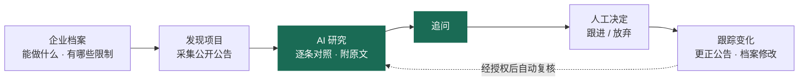
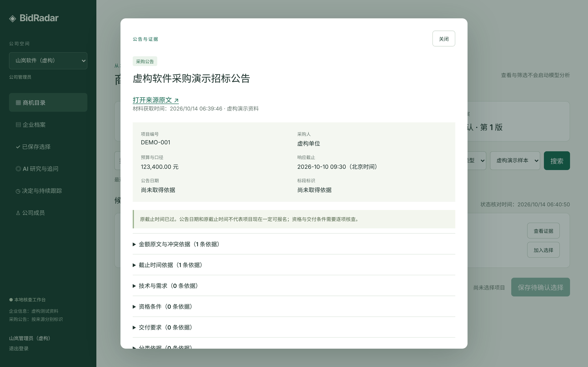
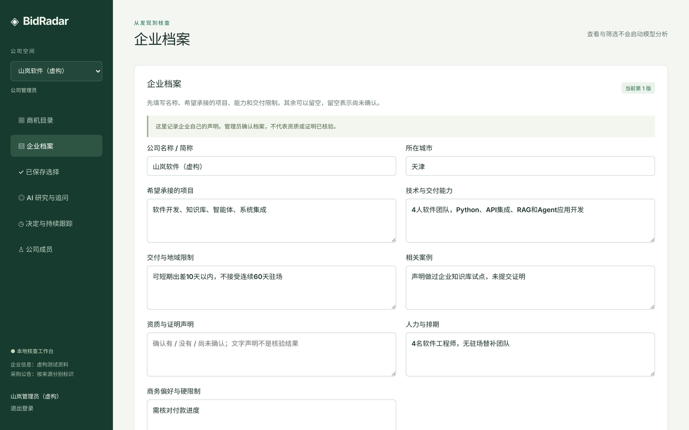
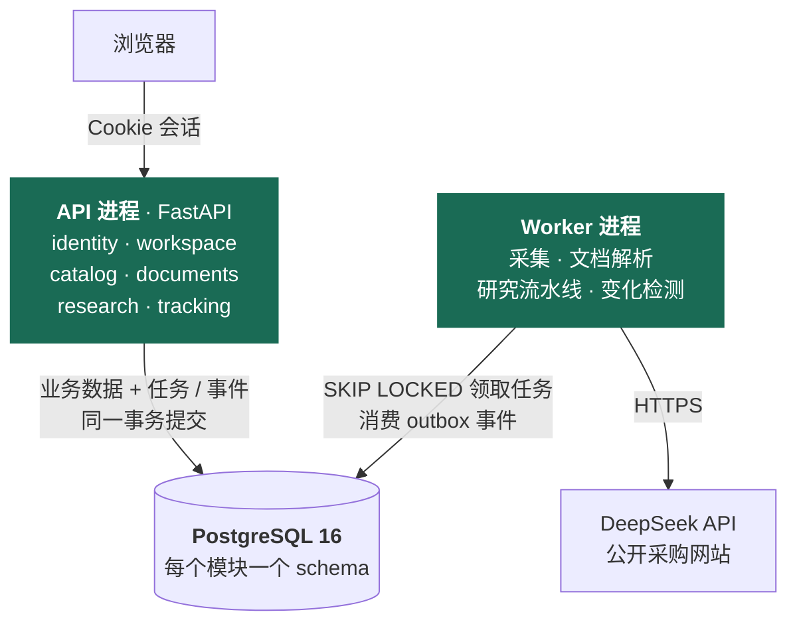
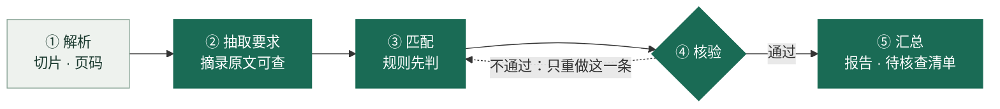

<div align="center">


# BidRadar

**证据优先的招投标研究 Agent**

帮软件公司和 AI 服务团队读懂中国公开采购项目：<br>
这个项目要求什么、我们能不能做、还缺哪些信息——每条结论都附原文。

[](https://github.com/chasen2041maker/BidRadar/actions/workflows/tests.yml)


[](https://github.com/astral-sh/uv)
[](https://github.com/astral-sh/ruff)
[](#路线图)

**简体中文** · [English](README.en.md)

[快速开始](#快速开始) · [设计亮点](#设计亮点) · [架构](#架构) · [研究流水线](#研究流水线) · [路线图](#路线图) · [文档](#文档)

</div>

<br>

<p align="center">
  
</p>

> [!NOTE]
> **项目正在进行 v2 改造。** 旧版（`services/`）已经端到端跑通；v2（`bidradar/`）改成模块化单体 + FastAPI + PostgreSQL。
> 阶段 0「地基」已于 2026-10-13 完成，**下一步是阶段 1「身份与公司」**。详见 [路线图](#路线图)。

## 为什么做这个

一家软件公司想接政府或国企的软件项目，每天要在大量招标公告里找合适的，再逐条核对资格、技术要求、交付期限和预算。这件事耗时，而且最怕两种错：把"不确定"当成"满足"，或者把一句原文读歪。

BidRadar 把这件事拆成可核查的几步，并给自己定了一条底线：**没有原文支撑的结论不发布**。



**不做的事：** 不预测中标概率，不自动投标或报价，不替人联系采购方。跟进还是放弃，永远由人来定。

## 设计亮点

| | 做法 |
| --- | --- |
| **证据优先** | 每条结论必须引用原文。五种状态：满足、不满足、未知、矛盾、不适用。**未知不当成满足**。企业档案是自述、没有核验，所以资格类要求一律判为未知 |
| **程序 + 模型双重核验** | 程序检查引用、金额角色、数字来源；再由一次独立的模型调用核验"结论是否真被原文支持"。不通过就修订，仍不通过就发布只列原文的保守版本 |
| **花钱有账** | 调模型前先预留费用，调用后按实际用量结算。三层上限：每轮 20 元、每家公司 10 元、每个任务 1 元。结果不确定（如断网）时不当成零，也不自动重试 |
| **崩溃可恢复** | 请求先落盘，响应先入账，任何位置崩溃都能续跑且不重复扣费。Worker 用租约加递增 epoch，过期的旧 Worker 写不进去 |
| **输入冻结** | 公告版本、档案版本、报告只插入不修改。新材料生成新报告，旧报告永远知道自己基于哪一版 |
| **外部内容只是数据** | 网页、附件、模型输出都不能当指令执行。研究工具只能读本任务冻结的材料，模型拿不到 URL、SQL 或文件路径 |
| **分层由机器守** | 6 条 import-linter 契约写进 CI：`models.py` 不依赖框架，跨模块只能调对方的 `service`，`agent/` 是纯逻辑 |

## 界面预览

<table>
  <tr>
    <td width="50%"></td>
    <td width="50%"></td>
  </tr>
  <tr>
    <td align="center"><sub>公告与证据：每个字段都能追溯到原文</sub></td>
    <td align="center"><sub>企业档案：成员提议，管理员确认，按版本保存</sub></td>
  </tr>
</table>

<sub>截图中的公司和公告均为虚构演示数据。</sub>

## 架构

v2 采用**模块化单体**：一份代码，API 和 Worker 两个进程，7 个业务模块各管一个 PostgreSQL schema。先把边界想清楚、代码写明白；边界清楚了，以后拆服务只是体力活。



为了以后能顺利拆分，模块之间守三条规矩：

1. **数据各管各的**：每个模块只读写自己的 schema。拆的时候整个 schema 搬走即可。
2. **只走公开入口**：模块之间只调用对方 `service.py` 的公开函数。拆的时候换成同名接口的 HTTP 客户端。
3. **异步用事件**：异步的事统一写 outbox 表。拆的时候把 outbox 接到 Redis Streams 或 RabbitMQ。

每个模块内部长一个样：`api → schemas → service → repo → tables → models`，上层可以依赖下层，反过来不行。

| 层面 | 选型 | 理由 |
| --- | --- | --- |
| Web | FastAPI + Pydantic v2 | 路由、校验、接口文档现成，不再手写 HTTP 层 |
| 数据 | PostgreSQL 16 · SQLAlchemy 2 · Alembic | 事务、行锁、JSONB、行级安全（RLS）、`SKIP LOCKED` 队列 |
| 后台任务 | PostgreSQL 任务表 + 租约 | 少一个组件；建任务和写业务数据在同一个事务里 |
| 大模型 | 自封装 `LLMClient`，DeepSeek 为一个实现 | 不绑框架，换模型只换一个类 |
| 工具链 | Python 3.12 · uv · ruff · pytest · import-linter · GitHub Actions | 主流、可复现，规则由 CI 执行 |

<details>
<summary>旧版架构（<code>services/</code>，v2 阶段 6 删除）</summary>

<br>

四个本地 HTTP 服务——workspace（:8965，浏览器入口）、catalog（:8966）、research（:8967）、tracking（:8968）——各有一个 SQLite 数据库，彼此通过回环 HTTP 和服务令牌通信。采集和规范化是两条命令行数据链。整套代码只用 Python 标准库。

详见 [架构说明](docs/architecture.md)。

</details>

## 研究流水线

旧版让一次模型调用同时读材料、找要求、对比企业、写理由、写摘要，任务太多就容易出错，只能靠往提示词里打补丁。v2 把它拆成五个小步骤：**能用程序判断的不交给模型；必须用模型的，每次只给它一个小问题。**



<sub>深色：会调用模型的步骤（③ 规则判不了的才问模型，④ 先跑程序检查，⑤ 只有摘要用模型）；浅色：纯程序。核验不通过最多重做 2 次，仍不通过就降为「未知」并标注。</sub>

- **每一步结果落库。** Worker 崩溃重启后，已完成的步骤直接复用。
- **出错只重做那一条。** 旧版只能整份报告重写。
- **同一份文件只抽取一次。** 同一份公开招标文件、同一版抽取规则，各公司共用抽取结果，省钱，也能单独评测。
- **追问是唯一的工具循环。** 只有追问真正需要模型自己决定"再查什么"，上限 6 次模型调用、12 次工具调用。

<details>
<summary>一个例子：为什么要拆</summary>

<br>

招标文件写着"合同签订后 60 日内完成系统开发"；企业档案写着"不接受超过 30 天的连续驻场"。

旧版模型曾把前者读成"需要驻场 60 天"，于是提示词里多了一条补丁规则："60 日开发期限不等于驻场"。

v2 里，② 抽取时这条被归为"交付"类；③ 匹配时，交付类要求只和"排期、团队规模"这类字段比较，驻场限制属于另一个维度，根本不会被拿来比。结论是"未知：档案里没有排期和人力计划"，并进入待核查清单。不需要任何补丁规则。

</details>

### 实测结果

旧版 Agent 于 2026-10-01 在 2 条真实公告 × 2 家虚构公司上测试（DeepSeek V4 Flash）：

| 指标 | 结果 |
| --- | --- |
| 真实任务 / 模型调用 | 39 个任务 · 212 次调用 |
| 总费用 | 约 4.48 元（按峰时价格估算） |
| 最终样本 | 5 个样本全部通过独立 AI 审查 |
| 对比规则基线 | Agent 能识别能力缺口（基线漏判 1 个），但会漏掉基线能列出的条目（漏 1 组） |
| 严重错误 | 两边都没有把资格"未知"误判成满足或不满足 |

样本太少，**不能说明准确率**。所以 v2 把评测当成一等公民：目标 30 个用例（至少 10 个人工标注），留三分之一作保留集；改提示词或规则必须跑全量评测，并在 PR 里贴前后对比。详见 [研究 Agent](docs/agent.md)。

## 路线图

### 方向

| 主线 | 从 | 到 |
| --- | --- | --- |
| **架构** | 四个服务 + 回环 HTTP + 手写 HTTP 层 | 模块化单体（FastAPI + PostgreSQL），边界清楚后 Worker 侧优先拆服务 |
| **研究质量** | 一次大调用 + 补丁式提示词 | 五步流水线 + 评测驱动，每一步可单测、可单独评测 |
| **数据入口** | 只有公告片段，资格和评分大多缺失 | 上传正式招标文件为主，公开采集负责发现项目（[决策 0010](docs/decisions/0010-upload-first-direct-analysis.md)） |

### 阶段

新代码写在 `bidradar/`，旧的 `services/` 照常能跑，到阶段 6 再删。每个阶段结束时项目都能跑、能测。

| 阶段 | 内容 | 完成标准 | 状态 |
| --- | --- | --- | --- |
| **0 地基** | uv 项目、FastAPI 骨架、PostgreSQL、Alembic、import-linter、CI | `GET /health` 能通，CI 全绿 | 已完成 · 10-13 · [#14](https://github.com/chasen2041maker/BidRadar/pull/14) |
| **1 身份与公司** | 登录、三种角色、档案版本、行级安全（RLS） | 两家公司互相看不到对方数据 | **下一步** |
| 2 商机与采集 | 迁移目录和 CCGP、海南采集适配器 | 现有 12 条真实公告能导入、能搜索 | 计划中 |
| 3 文档与切片 | 上传 PDF / Word、解析、切片、检索 | 上传真实招标文件，能看到带页码的切片 | 计划中 |
| 4 研究流水线 | 五个步骤、任务队列、预算账本、评测 v0 | 评测出指标；杀掉 Worker 能续跑且不重复扣费 | 计划中 |
| 5 追问与跟踪 | 追问 Agent、决定、关注、提醒、outbox | 变化后提醒只出现一次，授权后自动复核 | 计划中 |
| 6 收尾 | 前端接新接口、删除 `services/`、评测扩到 30 个 | 删掉旧代码后测试和评测全部通过 | 计划中 |

### 下一步：阶段 1「身份与公司」

- [ ] **登录**（示例）：从接口、service、repo、表、迁移到测试全部打通，作为同类功能的模板
- [ ] **退出、成员管理、档案提议与确认**：照着示例写
- [ ] **行级安全（RLS）**：每个事务开始时设置 `app.workspace_id`，作为租户隔离的第二道防线
- [ ] **验收**：两家公司互相看不到对方数据的测试通过；旧工作台的登录和档案功能能在新接口上用

### 之后（有明确理由时再做）

拆服务（Worker 侧优先）· Redis 缓存与限流 · K8s · 云端部署 · 扫描件 OCR · 中文分词或向量检索

### 还没有做

正式的用户系统 · 云端部署 · 持续自动采集 · 真实用户试用 · 人工标注的评测集

完整计划见 [v2 改造蓝图](docs/v2-blueprint.md)，进度见 [路线图文档](docs/roadmap.md)。

## 快速开始

### 体验完整流程（旧版，零依赖）

只需要 Python 3.10+，不用安装任何依赖。

```bash
git clone https://github.com/chasen2041maker/BidRadar.git && cd BidRadar
python scripts/run_research_workbench.py      # 启动四个服务，默认不调用真实模型
```

打开 <http://127.0.0.1:8965/>，测试账号在 `.bidradar-data/r12-workbench/demo-accounts.json`。

> [!TIP]
> 新克隆的仓库里没有真实公告样本。在商机目录把"数据范围"切到 **虚构演示样本**，就能看到演示公告。

```bash
python -m unittest discover -s tests -p 'test_*.py'           # 486 项测试
python scripts/run_data_demo.py                               # 离线演示数据链：采集 → 规范化 → 目录
python scripts/run_research_workbench.py --enable-model       # 允许调用 DeepSeek（会产生费用）
```

### 开发 v2

需要 Python 3.12、[uv](https://docs.astral.sh/uv/) 和 Docker。

```bash
docker compose up -d --wait db            # 启动 PostgreSQL 16
uv run alembic upgrade head               # 迁移数据库
uv run uvicorn bidradar.app.main:app      # 启动 API → http://127.0.0.1:8000/health
uv run pytest && uv run lint-imports      # 测试 + 分层规则检查
```

配置项见 [`.env.example`](.env.example)，不建 `.env` 时使用默认值。详见 [开发指南](docs/dev-guide.md#v2-新代码bidradar)。

## 项目结构

```text
bidradar/            v2：模块化单体
├── app/             组装：FastAPI 应用、配置、依赖注入
├── modules/         identity · workspace · catalog · ingestion · documents · research · tracking
│   └── <module>/    api · schemas · service · repo · tables · models
├── agent/           研究流水线（纯逻辑，不依赖 Web 和数据库）
│   ├── steps/       parse · extract · match · verify · compose
│   └── prompts/     提示词，一个步骤一个文件，带版本号
└── infra/           数据库会话、任务队列、outbox
migrations/          Alembic 迁移
tests_v2/            v2 测试（pytest，连真实 PostgreSQL）
services/            旧版四个服务（阶段 6 删除）
scripts/             启动、演示、评测脚本
tests/               旧版测试（unittest）
docs/                文档与决策记录
```

## 文档

| 文档 | 内容 |
| --- | --- |
| [v2 改造蓝图](docs/v2-blueprint.md) | 为什么改、改成什么样、分阶段怎么做 |
| [路线图](docs/roadmap.md) | 当前进度、已知短板、历程 |
| [研究 Agent](docs/agent.md) | AI 研究怎么工作、怎么核验、怎么控费，以及实测结果 |
| [架构说明](docs/architecture.md) | 旧版各部分怎么组织，一个请求怎么走 |
| [数据模型](docs/data-model.md) | 表结构和关键概念 |
| [开发指南](docs/dev-guide.md) | 本地运行、测试、提交约定、写注释和文档的规则 |
| [决策记录](docs/decisions/) | 10 条架构决策（ADR），每条一页：背景、决定、代价 |

## 参与开发

- 在独立分支开发，通过 PR 合并到 `main`；CI 跑旧版测试（Python 3.10 / 3.12）、v2 分层检查、迁移、pytest 和格式检查。
- 代码改了，相关文档和注释一起改。注释写"为什么这样做"，不复述代码。
- 三条红线：没有负责人同意不调用真实模型；不提交密钥和真实企业资料；浏览器传来的身份和角色不可信，每个动作前重新检查权限。

完整规则见 [AGENTS.md](AGENTS.md)，它同时适用于人类协作者和编码代理。

<br>

<div align="center">
<sub>企业信息均为虚构样例 · 公告来自中国政府采购网和海南省公共资源交易平台的有限公开样本</sub>
</div>
