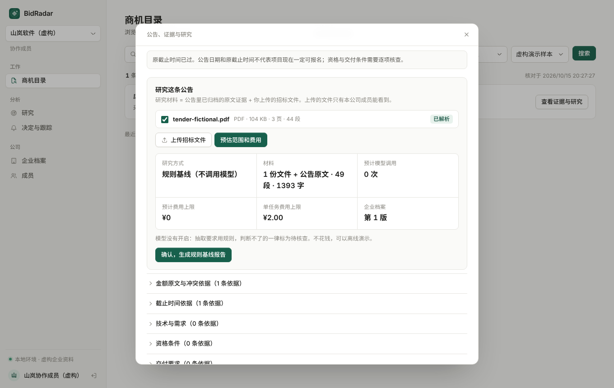
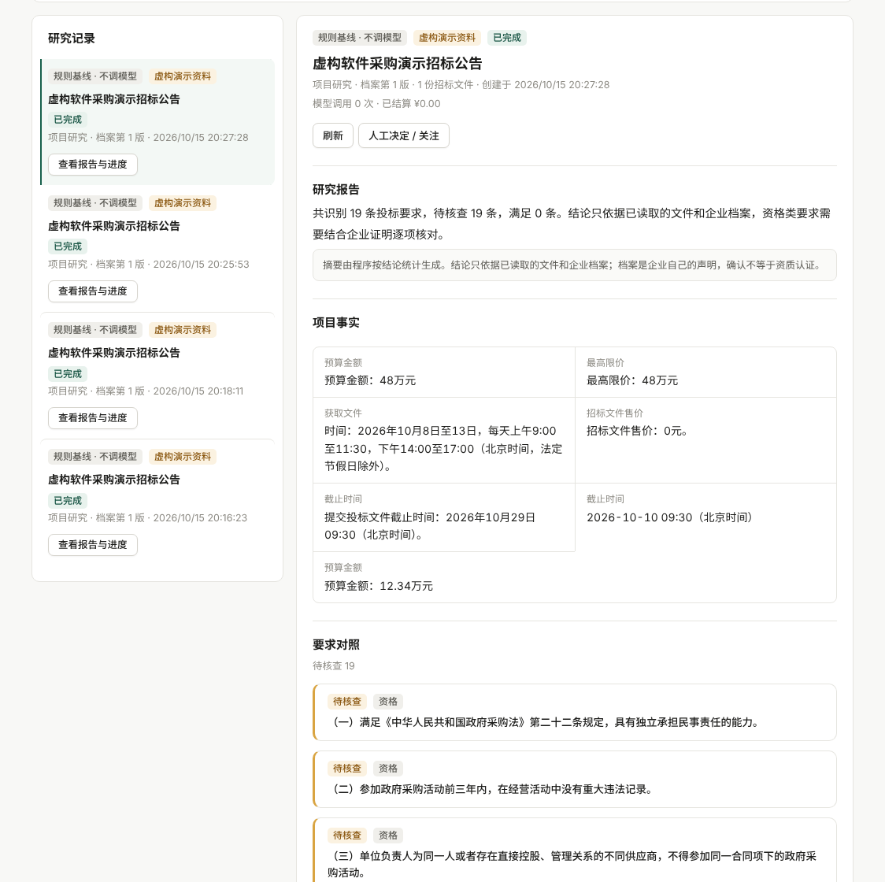
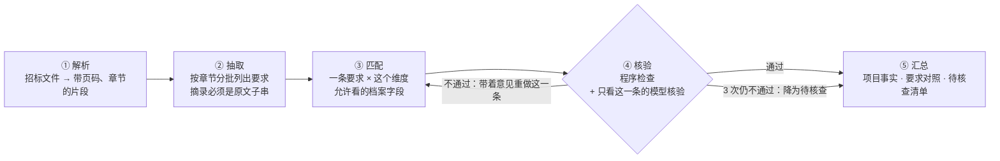
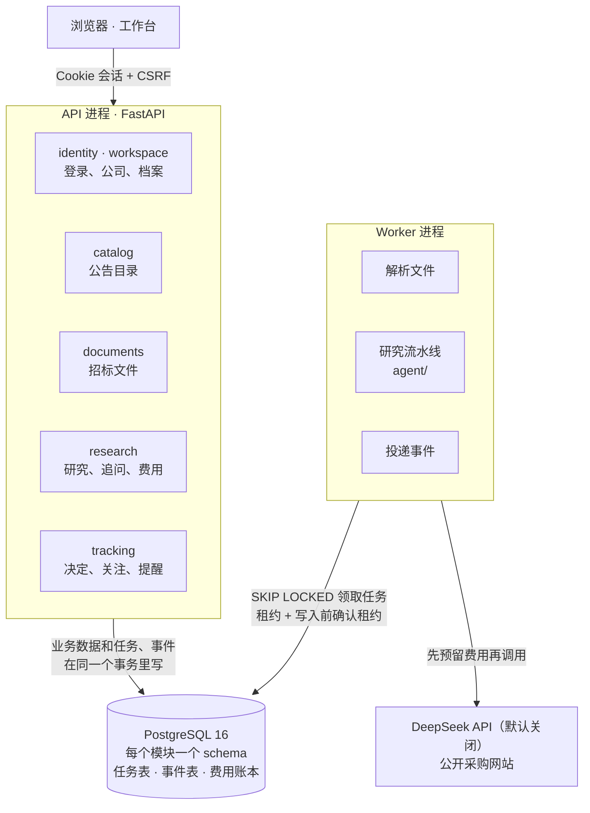

<div align="center">


# BidRadar

**证据优先的招投标研究 Agent**

帮软件公司和 AI 服务团队读懂公开采购项目：要求什么、能不能做、还缺什么。<br>
每条结论都附原文，判断不了的就说判断不了。

[](https://github.com/chasen2041maker/BidRadar/actions/workflows/tests.yml)


**简体中文** · [English](README.en.md)

</div>

## 它解决什么问题

一家四五个人的软件公司，在政府采购网上看到一条"智能知识库平台建设"的招标公告。要不要投，取决于几十页招标文件里散落的几十条要求：
资格、工期、驻场、私有化部署、付款方式、评分项……人工逐条对照要半天，而且最容易漏掉的恰恰是会让你废标的那一条。

BidRadar 做三件事：

1. **发现**：把公开采购公告整理成可搜索的目录，预算、截止时间这些字段都带着原文出处。
2. **研究**：上传招标文件，逐条列出要求，对照企业档案给出"满足 / 明确不满足 / 待核查"。每条结论附原文出处和档案原话，最后生成一份待核查清单。
3. **跟踪**：关注的公告出了更正、企业档案改了版，提醒一次；用户授权后自动复核。



<sub>先预估范围和费用，确认后才建任务。截图里的公司、公告和招标文件都是虚构的。</sub>



<sub>研究报告：项目事实、逐条要求对照。这张图是规则基线（没开模型）的结果，判断不了的一律待核查。</sub>

## 几条底线

1. **证据优先**：每条结论都要引用原文，摘录必须是原文的原话。没有依据就是"待核查"。未知不当成满足，也不当成不满足。
2. **输入固定**：每份报告都固定在当时的公告版本、档案版本和文件上。材料变了就生成新报告，旧报告不改，只标出"已有新版本"。
3. **花钱有账**：调模型之前先预留费用，用完按实际结算；三层额度（全部、每家公司、每个任务），用完就停。结果不确定时按已花计，停下来等人处理，不自动重试。
4. **外部内容都是数据**：公告、附件、模型输出里出现的"忽略以上规则"不会被执行。模型拿不到 URL、SQL 和文件路径。
5. **人来决定**：不预测中标概率，不自动投标、报价，也不替人联系采购方。

## 研究怎么做：流水线，不是一个大 Agent

旧版是一个工具循环 Agent，一次调用里读材料、找要求、对比企业、写结论。在真实公告上测出来的错误都很典型：
把"合同签订后 60 日内完成开发"当成"需要驻场 60 天"；预算和最高限价同为 48 万，拿一个去证明另一个；借用别的结论的原文来支持本条。
每个错误当时都靠加一条提示词规则修掉，换一批公告又会出新的。

v2 把研究拆成五个固定顺序的小步骤，每一步只给模型完成这一个小问题必需的材料，并用程序检查把它管住：



三个结构上的保证，替代了旧版越写越长的提示词：

- **维度表**（`agent/dimensions.py`）：抽取时给每条要求标一个维度，匹配时模型只看得到这个维度允许的档案字段。工期只能看人员排期，驻场只能看交付限制。想跨维度比较，也拿不到材料。
- **逐条核验**：每条结论单独核验，核验时看不到别的结论。不通过只重做这一条，不用整份报告重写。
- **程序检查**（`agent/checks.py`，不花钱，每条都做）：摘录是原文子串；档案原话是所列字段的子串；理由里的数字在原文或档案里出现；金额角色对得上；没有联系方式；没有"一定中标"这类断言。

只有**追问**保留工具循环，因为用户的问题事先不知道要查哪几段原文：四个只读工具，最多 6 次模型调用、12 次工具调用，回答要过引用和数字检查，不通过就只说"无法确认"。

每一步的结果都落库，Worker 崩了从断点续跑；每次模型调用有稳定的调用键，续跑时从账本取回已付费的响应，不会重复扣费。
没开模型时走**规则基线**，从头到尾不调模型，可以离线演示。详细设计见 [Agent 设计](docs/agent-design.md)。

## 评测：能定位到是哪一步错了

```bash
uv run python -m evals.run --step extract    # 抽取：召回率、精确率、维度准确率
uv run python -m evals.run --step match      # 匹配：输入用标准要求，不受抽取错误影响
uv run python -m evals.run --step verify     # 核验：故意喂错误结论，看能拦下多少、会不会误杀
uv run python -m evals.run --step all        # 端到端
```

评某一步时，它的上游一律用标准答案：抽取漏了一条，不该算成匹配的错。标准答案里除了"应得的状态"，还标了"最不能出现的错误"（比如标准是待核查，判成不满足就是严重错误），严重错误单独统计。
模型调用会录制下来，同样的请求再跑直接重放、不花钱；改了提示词，只有变了的那些调用才会真的发出去。

现在的核验评测（规则基线，没有模型核验）：

| 故意造的错误 | 拦下 |
| --- | --- |
| 拿别的维度的档案字段下结论 | 36 / 36 |
| 引用档案里不存在的"原话" | 36 / 36 |
| 理由里编造数字 | 36 / 36 |
| 档案原话是真的，结论却反了 | 0 / 28 —— 这一类只有模型核验能拦，正是它存在的理由 |

评测集现在只有 2 个用例（一份虚构招标文件 × 2 家虚构公司），数字只能说明流程跑通，不能说明准确率。

## 架构

一个模块化单体：一份代码、两个进程、一个 PostgreSQL。七个业务模块各占一个 schema，彼此只调用对方 `service.py` 里的函数，六条分层规则由 import-linter 在 CI 里检查。以后真要拆服务，按模块边界切开就行。



一个研究请求的完整路径、事件怎么变成提醒和复核，见 [架构说明](docs/architecture.md)。

## 快速开始

需要 Python 3.12、[uv](https://docs.astral.sh/uv/) 和 Docker。

```bash
uv sync
docker compose up -d --wait db                 # PostgreSQL 16
uv run alembic upgrade head
uv run python -m bidradar seed-demo            # 两家虚构公司、四个演示账号
uv run python -m bidradar ingest demo          # 用虚构数据离线跑一遍采集，记下输出的 run_id
uv run python -m bidradar ingest publish <run_id>

uv run python -m bidradar api                  # 终端 1：打开 http://127.0.0.1:8000/
uv run python -m bidradar worker               # 终端 2：后台任务
```

演示账号的密码在 `.bidradar-data/v2/demo-accounts.json`。用 `demo.member` 登录，在商机目录把数据范围切到"虚构演示样本"，
打开公告，上传 `tests/fixtures/tender-fictional.pdf`，预估费用后确认发起。

模型默认关闭，研究走规则基线，不花钱。要接真实模型，把 DeepSeek 密钥放在 `~/.bidradar/credentials/deepseek-api-key.txt`，
再设 `BIDRADAR_MODEL_ENABLED=true`；先用评测估算费用（`--llm live --enable-model --max-cost 1`），再定每个任务的上限。

```bash
uv run pytest            # 约 500 项测试，连 bidradar_test 库，不联网、不调真实模型
uv run lint-imports      # 分层规则
```

## 项目状态

v2 的阶段 0–6 都已完成，旧代码已删除（[路线图](docs/roadmap.md)）。这是一个学习项目：路线图一开始就约定，三块最核心的"硬骨头"由项目负责人亲手完成。
代码里给它们留好了接口、验收测试（默认跳过）和说明（[练习](docs/exercises.md)），其余部分都已可用：

| 练习 | 现在的行为 |
| --- | --- |
| 1. 行级安全（RLS） | 公司隔离靠第一道防线：每条查询都带公司条件。第二道防线（数据库自己挡）还没有 |
| 2. 匹配步骤和评测指标 | 匹配是保守的占位实现：所有要求都是"待核查"。抽取、核验、汇总、追问照常工作 |
| 3. outbox 消费者 | 事件已经写进 outbox，但还没人投递：变化提醒和自动复核暂时不会运行 |

其他已知限制：扫描件没有 OCR；评测集还很小，没有人工标注；真实模型还没在 v2 上跑过；数据采集只覆盖中国政府采购网和海南省公共资源交易平台的有限样本。

## 目录

```text
bidradar/
  app/        组装：路由、依赖注入、配置、Worker、命令行、前端（static/）
  modules/    identity  workspace  catalog  ingestion  documents  research  tracking
  agent/      研究流水线（steps/）、追问 Agent、程序检查、维度表、提示词（prompts/）
  infra/      数据库、任务队列、outbox、幂等键、文件存储
evals/        评测用例（YAML）、录制和重放、按步骤跑
migrations/   Alembic 迁移
tests/        和 bidradar/ 同样按模块分目录
docs/         设计、架构、数据模型、路线图、决策记录
```

## 了解更多

- [Agent 设计](docs/agent-design.md)：五个步骤各自喂给模型什么、检查什么、失败了怎么办、怎么评测
- [研究 Agent](docs/agent.md)：研究现在怎么工作，以及 v1 实测出的问题
- [架构说明](docs/architecture.md) · [数据模型](docs/data-model.md) · [开发指南](docs/dev-guide.md)
- [路线图](docs/roadmap.md) · [v2 改造蓝图](docs/v2-blueprint.md) · [练习](docs/exercises.md) · [决策记录](docs/decisions/) · [协作规则](AGENTS.md)
