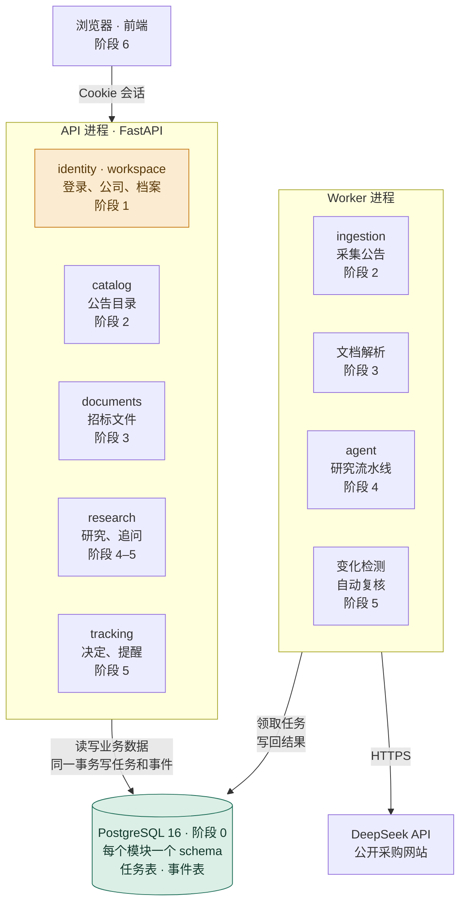
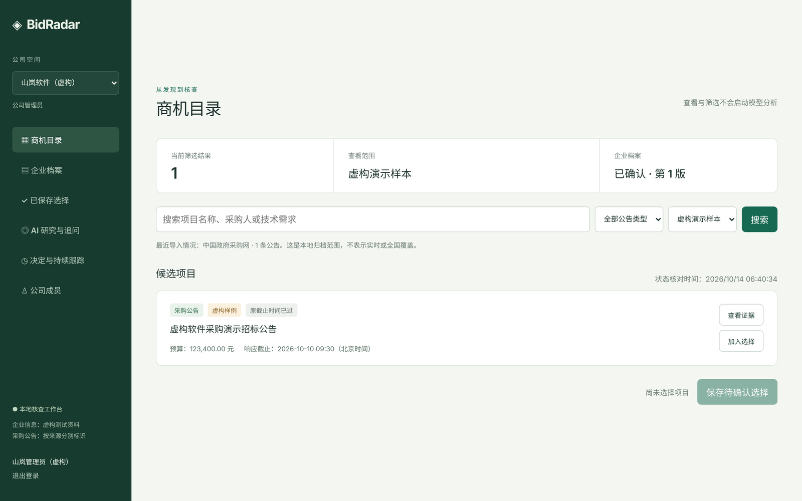

<div align="center">


# BidRadar

**证据优先的招投标研究 Agent**

帮软件公司和 AI 服务团队读懂公开采购项目：要求什么、能不能做、还缺什么。<br>
每条结论都附原文。

[](https://github.com/chasen2041maker/BidRadar/actions/workflows/tests.yml)


**简体中文** · [English](README.en.md)

</div>

## 核心点

1. **证据优先**：每条结论都要引用原文。没有依据的就标"未知"，未知永远不当成满足。
2. **输入冻结**：每份报告都固定在当时的公告版本和企业档案版本上，材料更新就生成新报告，旧报告不改。
3. **花钱有账**：调模型前先预留费用，用完按实际结算。结果不确定时停下来等人处理，不自动重试。
4. **人来决定**：不预测中标概率，不自动投标，也不替人联系采购方。跟进还是放弃，由人决定。

## 计划

旧版已经跑通完整流程：企业档案 → 商机目录 → AI 研究 → 追问 → 跟踪变化。现在在做 **v2 改造**，方向是三件事：

- **架构**：四个服务合成一个模块化单体（FastAPI + PostgreSQL），边界清楚了再拆服务。
- **研究**：一次大模型调用拆成五步流水线（解析 → 抽取 → 匹配 → 核验 → 汇总），每一步都能单独测试和评测。
- **材料**：以用户上传的正式招标文件为主，公开采集只负责发现项目。

| 阶段 | 做什么 | 状态 |
| --- | --- | --- |
| [0 地基](docs/roadmap.md#阶段-0-地基) | 项目骨架、数据库、迁移、CI | 已完成 |
| [1 身份与公司](docs/roadmap.md#阶段-1-身份与公司) | 登录、三种角色、企业档案、数据隔离（RLS） | **下一步** |
| [2 商机与采集](docs/roadmap.md#阶段-2-商机与采集) | 迁移公告目录和采集器 | 计划中 |
| [3 文档与切片](docs/roadmap.md#阶段-3-文档与切片) | 上传并解析招标文件（第一个后台任务） | 计划中 |
| [4 研究流水线](docs/roadmap.md#阶段-4-研究流水线) | 五步研究、费用账本、评测 | 计划中 |
| [5 追问与跟踪](docs/roadmap.md#阶段-5-追问与跟踪) | 追问、关注、变化提醒、自动复核 | 计划中 |
| [6 收尾](docs/roadmap.md#阶段-6-收尾) | 前端接新接口，删除旧代码 | 计划中 |

点阶段名，能看到这个阶段要建的表和接口、按什么顺序做、哪块由你主写、怎样算完成。

**更远**：边界稳定后先拆 Worker；Redis、K8s、云端部署等有明确需要时再做。

## 架构

图里每个方框都标了阶段号：做到哪个阶段，就是在建图里的哪一块。



<sub>绿色：已完成 · 橙色：下一步 · 其余：计划中</sub>

## 界面



<sub>截图里的公司和公告都是虚构演示数据。</sub>

## 快速开始

体验完整流程（旧版，只需要 Python 3.10+）：

```bash
python scripts/run_research_workbench.py    # 打开 http://127.0.0.1:8965/
```

测试账号在 `.bidradar-data/r12-workbench/demo-accounts.json`。在商机目录把数据范围切到「虚构演示样本」，就能看到演示公告。

开发 v2（需要 Python 3.12、[uv](https://docs.astral.sh/uv/) 和 Docker）：

```bash
docker compose up -d --wait db && uv run alembic upgrade head
uv run uvicorn bidradar.app.main:app        # 打开 http://127.0.0.1:8000/health
```

## 了解更多

- [路线图](docs/roadmap.md)：每个阶段建什么、怎么做、做到哪了
- [v2 改造蓝图](docs/v2-blueprint.md)：为什么改、改成什么样
- [研究 Agent](docs/agent.md)：研究怎么工作，以及实测结果
- [开发指南](docs/dev-guide.md) · [决策记录](docs/decisions/) · [协作规则](AGENTS.md)
