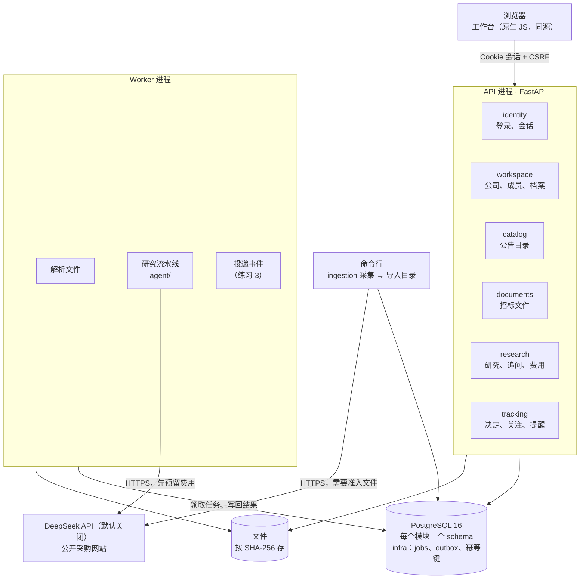

# 架构说明

系统现在怎么组织、一个请求怎么走。为什么这样设计见 [v2 改造蓝图](v2-blueprint.md)，怎么跑起来见 [开发指南](dev-guide.md)。

## 一句话

一个模块化单体：一份代码、两个进程（API 和 Worker）、一个 PostgreSQL。七个业务模块各占一个 schema，彼此只调用对方 `service.py` 里的函数；
异步的事写进任务表和事件表，由 Worker 执行。以后真要拆服务，按模块边界切开就行（决策 0008）。

## 整体结构



- **API 进程**（`python -m bidradar api`）：所有 HTTP 接口，外加工作台的三个静态文件（`/`、`/app.js`、`/style.css`）。同源提供，所以 CSP 可以写死"只允许本站的脚本和样式"。
- **Worker 进程**（`python -m bidradar worker`）：从 `infra.jobs` 领取任务（`FOR UPDATE SKIP LOCKED` + 租约），现在有两种任务：解析上传的文件、执行研究；另外投递 outbox 里的事件。可以开多个。
- **命令行**（`python -m bidradar ingest ...`）：采集公开公告，规范化后导入目录。采集默认不联网，每个请求都要过来源准入、robots.txt、公网 DNS 检查、固定 IP 连接、请求次数和字节上限。

## 代码分层

```text
bidradar/app/       组装：路由、依赖注入（会话、当前用户、CSRF）、配置、Worker、命令行、前端
bidradar/modules/   业务模块。每个模块内部：api → schemas → service → repo → tables → models
bidradar/agent/     研究流水线和追问 Agent，纯逻辑，不碰数据库和 Web
bidradar/infra/     数据库、任务队列、outbox、幂等键、文件存储、时钟
```

依赖只能从上往下，六条规则由 import-linter 在 CI 里检查（见 [开发指南](dev-guide.md#依赖规则)）。
`agent/` 需要的东西（模型客户端、步骤存储、守卫、账本）都由 research 模块从参数传进去，所以流水线不连数据库也能单测和离线评测。

| 模块 | 做什么 | 别的模块调它的什么 |
| --- | --- | --- |
| identity | 用户、密码、会话、登录限流 | `current_user()`、`check_csrf()` |
| workspace | 公司、成员和三种角色、档案提议和确认 | `authorize()`（每个动作之前都调）、`get_profile()` |
| catalog | 规范化公告、版本、关联、搜索 | `get_notice()`、`research_bundle()`、`get_observations()` |
| ingestion | 采集、归档原件、规范化 | —（命令行入口，结果交给 catalog 导入） |
| documents | 上传、解析、切片 | `get_chunks()`、`list_documents()` |
| research | 研究任务、步骤存储、费用账本、追问 | `create_reassessment()`、`cancel_run_internal()` |
| tracking | 决定、关注、变化检测、提醒、自动复核 | —（处理事件） |

## 一个研究请求怎么走

```text
1. 浏览器  POST /api/workspaces/{公司}/documents          上传招标文件（multipart）
   documents.upload()：检查"写"权限 → 按 SHA-256 存文件 → 建 documents 行 + 排一个解析任务（同一个事务）
2. Worker  documents.handle_parse()：解析 PDF / Word → 切片 → 写 chunks（每一步之前确认租约还是自己的）

3. 浏览器  POST .../research/estimate {notice_id, document_ids}
   research.estimate_run()：检查"分析"权限 → 取公告包和片段 → 算调用次数和费用上限。不调模型，不花钱
4. 浏览器  POST .../research/runs {notice_id, document_ids, key}
   research.create_analysis()：再查一次权限 → 固定输入（档案版本、目录快照、公告版本、文件）
     → 建 runs 行 + 排一个研究任务 + 记幂等键（同一个事务）→ 返回任务 ID

5. Worker  research.handle_run()：
     → 守卫：任务没取消、发起人仍有权限、成员版本和档案版本没变、续上租约
     → ResearchPipeline.run()：抽取 → 匹配 → 核验 → 汇总，每一步结果存进 run_steps
       模型调用：BudgetedLLM 先在 llm_calls 预留费用（提交）→ 发请求 → 结算
     → 存报告，任务变成 succeeded / partial；同一个事务里发 research.run_finished 事件
6. 浏览器  每 3 秒 GET .../research/runs/{id}，完成后显示报告，并标出档案或公告有没有新版本
```

## 变化怎么变成一次复核

```text
catalog 导入新版本 ──outbox──► tracking.handle_notice_version_added()
                                 → 每个基线比它旧的关注：取新的公告包，和基线比较
                                 → 有实质变化：记 change、发提醒（按 dedupe_key 只发一次）
                                 → 关注里授权了自动复核、委托没过期、发起人权限没变：
                                   research.create_reassessment()（同一个事务，按发起人的权限检查）
workspace 确认档案   ──outbox──► tracking.handle_profile_confirmed()   同上，来源是档案
workspace 改成员     ──outbox──► tracking.handle_access_changed()      委托作废，没结束的复核取消
research 任务结束    ──outbox──► tracking.handle_run_finished()        记下复核结果，发提醒
```

投递 outbox 的消费者是练习 3。在它完成之前，事件会写进 outbox，但不会被处理。

## 几条贯穿全局的规则

- **证据优先**：每条结论都要有原文引用；没有依据就是"待核查"。未知不当成满足，也不当成不满足。
- **固定输入**：任务创建时就固定了用哪个版本的档案、公告和文件。之后它们变了，旧报告不变，只是标出"已有新版本"。
- **先存再做**：请求先持久化、返回编号，再由 Worker 执行。刷新页面、断网重试都不会重复建任务。
- **幂等和乐观锁**：修改类请求带幂等键；会被并发修改的记录带版本号。
- **每个动作前重新检查权限**：被移出公司的人，下一个动作就会被拒绝；Worker 每一步之前也查一次。
- **费用先预留**：调模型之前先在账本里预留；结果不确定时不当作免费，也不自动重试。
- **外部内容都是数据**：网页、附件、模型输出不能当作指令执行；页面里一律用 `textContent` 显示。
- **不替用户行动**：不自动投标、报价或联系采购方。

## 安全

- 会话：HttpOnly、SameSite=Strict 的 `br_session` Cookie，8 小时过期；库里只存令牌的哈希。
- CSRF：修改类请求要带 `X-CSRF-Token` 头（值来自 `br_csrf` Cookie），并检查 `Origin`。
- `TrustedHost` 挡 DNS 重绑定；CSP、`nosniff`、`no-referrer`；接口响应 `Cache-Control: no-store`。
- 公司隔离：每条查询都带 `workspace_id`，公司 ID 取自路径但权限由服务端查。第二道防线（行级安全）是练习 1。
- 上传：限制大小（20 MB）和类型（按文件头判断，不信扩展名）；Word 文件防 zip 炸弹。

## 代码阅读顺序

如果只有一个小时：

1. `bidradar/app/health.py`：最短的请求路径，看清分层。
2. `bidradar/modules/workspace/service.py` 的 `authorize()`：每个动作之前都调它。
3. `bidradar/modules/research/service.py` 的 `create_analysis()` 和 `handle_run()`：一次研究的一生。
4. `bidradar/agent/pipeline.py`：五个步骤怎么串起来、怎么续跑。
5. `bidradar/agent/steps/verify.py`：整套设计的重心，看程序检查管住了什么。
6. `bidradar/modules/tracking/service.py` 开头的说明：事件怎么变成提醒和复核。
