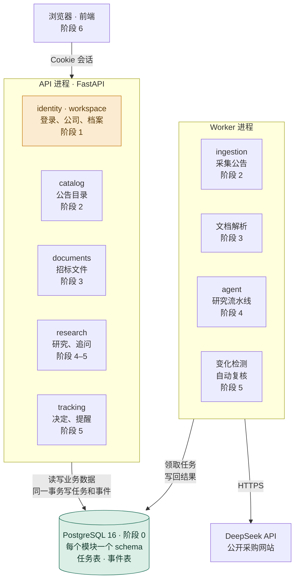

# 路线图

更新：2026-10-14

这份文档回答三个问题：现在做到哪了、v2 每个阶段建系统里的哪一块、到了某个阶段具体怎么做。为什么这样设计，见 [v2 改造蓝图](v2-blueprint.md)。

## 现在在哪

旧版（`services/`）的完整流程已经跑通：登录 → 企业档案 → 商机目录 → AI 研究 → 追问 → 跟进决定 → 关注 → 变化提醒 → 自动复核。v2（`bidradar/`）完成了阶段 0，**下一步是阶段 1「身份与公司」**。

| 部分 | 状态 |
| --- | --- |
| 数据采集 | 中国政府采购网、海南省公共资源交易平台：有限公开样本已跑通（12 条真实公告、1 份公开 PDF）。天津开放接口：代码已写，但平台仍拒绝开发者令牌 |
| 商机目录 | 可用：搜索、详情、版本历史、更正和结果公告的关联 |
| 工作台 | 可用：登录、三种角色、档案提议和确认、选择 |
| AI 研究 | 可用：5 个最终样本通过独立 AI 审查；样本太少，不能说明准确率 |
| 跟踪 | 可用：决定、关注、变化检测、站内提醒、自动复核 |
| 测试 | 旧代码 486 项，Python 3.10 和 3.12 均通过；v2 新代码 7 项 pytest 和 6 条分层契约 |
| v2 新代码 | 阶段 0 地基已完成：`bidradar/` 骨架、FastAPI、PostgreSQL、Alembic、分层规则检查、CI。还没有业务功能 |

还没有做的：完整招标文件的获取和解析、正式的用户系统和行级安全（RLS）、Redis / K8s / 云端部署、真实用户试用和人工标注的评测集、持续自动采集。

## 架构：每个阶段建哪一块

图里每个方框都标了阶段号。做到哪个阶段，就是在建图里的哪一块。

绿色：已完成 · 橙色：下一步 · 其余：计划中

三条规矩保证以后能顺利拆成服务（蓝图 2.3 节）：

1. 每个模块只读写自己的 schema。
2. 模块之间只调用对方 `service.py` 里的公开函数。
3. 异步的事统一写 outbox 事件表。

## 每个功能都按这个顺序写

不管在哪个阶段，加一个功能（比如"登录"或"确认档案"）都是同一套顺序。以 `modules/identity/` 为例：

| 步骤 | 写在哪 | 要点 |
| --- | --- | --- |
| 1. 建表 | `tables.py` | 写完生成迁移：`uv run alembic revision --autogenerate --rev-id 0002 -m "create identity tables"`，**读一遍迁移再提交**，然后 `uv run alembic upgrade head` |
| 2. 业务规则 | `models.py` | 纯 Python，比如"会话 8 小时过期""最后一个管理员不能被撤权"。写纯逻辑单测，不连数据库 |
| 3. 读写数据库 | `repo.py` | 函数接收会话参数，只读写，不提交事务 |
| 4. 业务动作 | `service.py` | 一个函数一个动作：先检查权限，再调 repo，最后提交事务。别的模块只能调这里 |
| 5. 接口 | `schemas.py` + `api.py` | 定义请求和响应结构；路由只调 service。在 `app/main.py` 挂上 router |
| 6. 测试 | `tests_v2/` | 服务测试用 `db_session` 夹具，接口测试用 `client` 夹具，都在回滚的事务里跑 |
| 7. 检查 | 命令行 | `uv run pytest && uv run lint-imports && uv run alembic check`，全过再开 PR |

每一层为什么这样分、依赖规则和迁移规矩，见 [开发指南](dev-guide.md#v2-新代码bidradar)。

**每个阶段的节奏**（蓝图第 11 节）：

1. AI 先写一个完整示例，从表到测试全部打通，并讲清每层为什么这样放。
2. 你照着示例写同类功能，AI 审查。
3. 每个阶段挑一块硬骨头由你主写。
4. 能脱稿讲清一条请求从浏览器到数据库的完整路径，再进下一阶段。

## 阶段 0 地基

**状态：已完成（2026-10-13，[PR #14](https://github.com/chasen2041maker/BidRadar/pull/14)）**

做了什么：

- `bidradar/` 目录按蓝图 3.1 节建好：`app/`、`modules/`（7 个模块，每个模块 6 个文件，目前只有说明）、`agent/`、`infra/`。
- FastAPI 应用和 `GET /health`：数据库连得上返回 200，连不上返回 503。
- `docker-compose.yml` 启动 PostgreSQL 16；Alembic 第一个迁移给每个模块建一个 schema。
- 6 条 import-linter 契约，对应蓝图 3.3 节的依赖规则。
- CI 新增 v2 任务：分层检查、迁移、pytest、启动 API 访问 `/health`。

最短的完整请求路径在 `bidradar/app/health.py`：路由 → `deps.py` 注入会话 → `infra/db.py` 执行 SQL → 数据库。

## 阶段 1 身份与公司

**状态：下一步**

**目标**：用户能登录；公司、成员、三种角色和企业档案版本在新接口上可用；两家公司的数据互相隔离。

**要建的东西**

| 模块 | 表 | 对外提供 |
| --- | --- | --- |
| identity | users、sessions、login_limits | `current_user()` |
| workspace | workspaces、memberships、membership_events、profile_proposals、profile_versions | `authorize()`、`get_profile()` |

接口路径沿用旧工作台（`/api/login`、`/api/session`、`/api/workspaces/{公司}/profile` 等），阶段 6 前端换接口时改动最小。

**怎么做**

1. **AI 示例：登录。** users、sessions 表和迁移 → 密码校验和会话过期规则 → repo → `service.login()`、`current_user()` → 接口和 Cookie → 三层测试。`deps.py` 加上"当前用户"依赖。
2. **你照着写：** 退出、读取当前会话、登录限流。
3. **你照着写：** 公司、成员、三种角色，以及 `authorize()`。别的模块要检查权限都调它。
4. **你照着写：** 档案提议 → 管理员确认 → 生成新版本。并发修改用 `version` 列做乐观锁，重复提交用幂等键。
5. **你主写（硬骨头）：行级安全。** 每个事务开始时执行 `SET LOCAL app.workspace_id = ...`，给私有表加 RLS 策略，再写一个"两家公司互相看不到"的测试。

**完成标准**：两家公司互相看不到对方数据的测试通过；旧工作台的登录和档案功能能在新接口上用。

**能学到**：会话安全（HttpOnly Cookie、CSRF）、密码哈希、事务边界、乐观锁、幂等、RLS。

**参考旧代码**：`services/workspace/store.py`（登录、成员、档案部分）、`services/workspace/domain/access_policy.py`（三种角色能做什么）。

## 阶段 2 商机与采集

**状态：计划中**

**目标**：现有 12 条真实公告能导入新系统，能搜索。

**要建的东西**

| 模块 | 表 | 对外提供 |
| --- | --- | --- |
| catalog | notices、notice_versions、notice_links | `search()`、`get_notice()` |
| ingestion | sources、fetch_runs、captures | 采集结果交给 catalog 导入 |

**怎么做**

1. **AI 示例：** 导入一条规范化公告，写进 notices 和 notice_versions。公告版本只插入、不修改。
2. **你照着写：** 搜索（先用 ILIKE 关键词匹配）、详情、版本历史、更正和结果公告的关联。
3. **搬采集适配器：** CCGP、海南的解析代码大多是纯函数，挪进 ingestion 时连同测试一起搬。
4. **守住边界：** 采集结果通过 `catalog.service` 导入，ingestion 不能直接写 catalog 的表。
5. **你主写（建议）：** 去重。同一条公告抓了多次，按版本保存，晚到的旧数据不能把当前版本倒退回去。

**完成标准**：12 条真实公告能导入、能搜索；重复导入不产生重复数据。

**能学到**：数据管道、去重、版本化、只插不改。

**参考旧代码**：`services/ingestion/`（采集，解析器在 `sources/`）、`services/processing/normalize.py`（规范化）、`services/catalog/`（目录）。

## 阶段 3 文档与切片

**状态：计划中**

**目标**：上传一份真实招标文件，能看到带页码的切片。这也是 Worker 的第一个后台任务。

**要建的东西**

| 模块 | 表 | 对外提供 |
| --- | --- | --- |
| documents | documents、chunks | `get_chunks()`、`search_chunks()` |
| infra | jobs（任务表） | `enqueue()`、Worker 领取任务 |

**怎么做**

1. **AI 示例：** 任务表和 Worker。领取任务用 `SELECT … FOR UPDATE SKIP LOCKED` 加租约；建任务和写业务数据在同一个事务里提交。
2. **你照着写：** 上传接口。按 sha256 去重，按公司隔离，限制文件大小和类型。
3. **你照着写：** 解析任务。PDF 用 pdfplumber，Word 用 python-docx，切片带页码和章节路径。
4. **你主写（建议）：** 中途杀掉 Worker，租约过期后任务能被重新领取，而且不会被处理两次。

**完成标准**：上传真实招标文件能看到带页码的切片；Worker 中断后任务能续上。

**能学到**：文件存储、文档解析、后台任务、租约。

**注意**：PyMuPDF 是 AGPL 许可，公开仓库不用。扫描件的 OCR 以后再做。

## 阶段 4 研究流水线

**状态：计划中**

**目标**：五步研究跑通，评测能出指标，Worker 中断后能续跑且不重复扣费。

**要建的东西**

| 模块 | 表 | 对外提供 |
| --- | --- | --- |
| research | runs、run_steps、requirement_sets、requirements、findings、reports、llm_calls | `create_run()`、`get_report()` |
| agent | 不建表，纯逻辑 | `ResearchPipeline`、`LLMClient` |

**怎么做**

1. **AI 示例：** `LLMClient` 接口、测试用的假实现，以及 `BudgetedLLM`：先预留费用 → 调用 → 按实际用量结算；结果不确定时任务停下等人。
2. **编排：** `pipeline.py` 的 `step()` 把每一步结果写进 run_steps，重启后已完成的步骤直接复用（蓝图 6.6 节有示意代码）。
3. **五个步骤，按顺序写：**
   - ① 解析：直接用阶段 3 的切片。
   - ② 抽取要求：摘录必须能在所引切片里原样找到；同一文件、同一版本只抽一次，各公司共用。
   - ③ 匹配：确定性规则先判，剩下的才问模型；每类要求只和同一维度的档案字段比较。
   - ④ 核验：每条结论只用自己的引用核验；不通过只重做这一条，最多 2 次，仍不通过降为"未知"。
   - ⑤ 汇总：待核查清单由程序从"未知"结论生成。
4. **你主写（硬骨头）：** 匹配步骤和评测指标。
5. **评测 v0：** 把现有 2 条公告 × 2 家虚构公司做成 4 个用例，用 `uv run python -m evals.run --step extract` 这样的命令按步骤跑。

**完成标准**：4 个评测用例跑通并出指标；中途杀掉 Worker 能续跑，且不重复扣费。

**能学到**：大模型结构化输出、队列和租约、成本控制、评测驱动开发。

**规矩**：提示词放 `agent/prompts/`，文件名带版本号；改提示词或规则必须跑全量评测，在 PR 里贴前后对比。

**参考旧代码**：`services/research/budget.py`（费用账本）、`evidence.py`（各种检查，拆到 `agent/checks.py`）、`agent.py`（旧的一次性 Agent，对照看哪些补丁规则被通用检查取代，见蓝图 6.4 节）。

## 阶段 5 追问与跟踪

**状态：计划中**

**目标**：能围绕报告追问；公告或档案变化后，提醒只出现一次，经授权后自动复核。

**要建的东西**

| 模块 | 表 | 对外提供 |
| --- | --- | --- |
| tracking | decisions、watches、changes、notifications | `set_decision()`、`watch()` |
| research | 沿用阶段 4 的表 | `ask()`（追问） |
| infra | outbox（事件表） | 发布和消费事件 |

**怎么做**

1. **AI 示例：** outbox 表和投递：业务数据和事件在同一个事务里写入，再由 Worker 投递。
2. **你照着写：** 跟进 / 放弃决定、关注开关、站内提醒。
3. **追问 Agent：** 唯一的工具循环。工具只有 `search_chunks`、`read_chunk`、`get_finding`、`get_profile`；最多 6 次模型调用、12 次工具调用；回答复用阶段 4 的核验。
4. **你主写（硬骨头）：** outbox 消费者。同一个事件投递两次也只处理一次。
5. **串起来：** 变化检测 → 提醒 → 用户授权后自动复核。没有授权，不调用模型。

**完成标准**：同一个变化只提醒一次；授权后自动复核；未授权时不产生模型费用。

**能学到**：事件驱动、outbox、去重、最终一致性。

**参考旧代码**：`services/tracking/`（`diff.py` 是变化对比）。

## 阶段 6 收尾

**状态：计划中**

**怎么做**

1. 前端（现在在 `services/workspace/web/`）改接新接口。之前先定下是否继续用原生 JS（蓝图 13 节第 4 项，目前唯一没定的事）。
2. 删除 `services/` 和旧测试 `tests/`，`tests_v2/` 改名为 `tests/`。
3. 评测扩到 30 个用例，覆盖软件开发、运维服务、AI 算力、设备采购等类型；至少 10 个由你亲自标注，三分之一留作保留集。
4. 文档定稿：架构说明、数据模型改成描述 v2。

**完成标准**：删掉旧代码后，全部测试和评测仍然通过。

## 之后（有明确理由时再做）

- **拆服务**：先拆 Worker 一侧（采集和研究流水线），它们慢、依赖外部网站和大模型，需要单独限流和扩容。拆法：把 schema 整个搬走，函数调用换成 HTTP，outbox 接到 Redis Streams 或 RabbitMQ。
- Redis 缓存和限流、K8s、云端部署。
- 中文分词或向量检索（数据量上来以后）、扫描件 OCR。

## 历程

| 时间 | 做了什么 |
| --- | --- |
| 2026-09-11 ~ 09-15 | 规划文档；确定首批市场、租户隔离方式、公司三种角色；第一个权限函数（PR #1–#8） |
| 2026-09-15 ~ 09-30 | 确定"先筛选、再研究"的两阶段流程；CCGP 解析器；采集流水线（PR #9、#10） |
| 2026-09-30 | 真实公开样本跑通整条数据链（PR #11） |
| 2026-10-01 | 工作台（PR #12）；AI 研究和跟踪（PR #13） |
| 2026-10-12 | 文档重组为人话版本；全部代码注释重写；拆分 `run_agent`；修复 Python 3.10 兼容问题；统一代码格式；写 v2 改造蓝图 |
| 2026-10-13 | 拍板蓝图第 13 节剩下的几项；v2 阶段 0 地基：`bidradar/` 骨架、FastAPI、PostgreSQL、Alembic、import-linter、CI（PR #14） |
| 2026-10-14 | README 重写为中英文两版（PR #15）并精简；工作台前端重新设计：浅色侧栏和线条图标、列表式商机目录、浮动选择栏和提示，接口和业务逻辑不变；路线图加入架构图和每个阶段的做法 |

每个阶段的原始记录在 [历史文档](archive/) 里。
