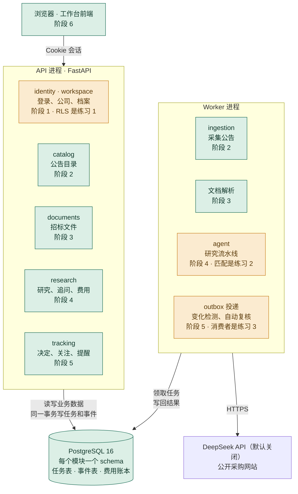

# 路线图

更新：2026-10-22

这份文档回答三个问题：现在做到哪了、每个阶段建了系统里的哪一块、还剩什么。为什么这样设计，见 [v2 改造蓝图](v2-blueprint.md)。

## 现在在哪

**v2 的阶段 0–6 都已完成，旧代码（`services/`、旧测试、`scripts/`）已经删除。** 完整流程在新代码上跑通：
登录 → 企业档案 → 商机目录 → 上传招标文件 → 预估费用 → 研究 → 追问 → 决定与关注 → 变化提醒 → 自动复核。

还差三块，是路线图一开始就写明"你主写"的硬骨头。代码里只留了接口、验收测试（默认跳过）和说明，见 [练习](exercises.md)：

| 练习 | 没做完时的影响 |
| --- | --- |
| 1. 行级安全（RLS） | 公司之间的隔离只靠第一道防线：每条查询都带公司条件。功能不受影响 |
| 2. 匹配步骤和评测指标 | 研究报告里的要求全部是"待核查"：抽取、核验、汇总、追问都能用，但不会给出满足或不满足 |
| 3. outbox 消费者 | 事件写进了 outbox，但没人投递：变化检测、站内提醒和自动复核不会运行 |

| 部分 | 状态 |
| --- | --- |
| 数据采集 | 中国政府采购网、海南省公共资源交易平台：有限公开样本已跑通。天津开放接口：代码已写，平台仍拒绝开发者令牌，条款核对 10-29 到期。2026-10-22 检查：离线整条链路正常，修了两个问题；真实网站这次没能联网核对，要在本机跑一次（见[开发指南](dev-guide.md#采集真实网站)） |
| 商机目录 | 可用：搜索、详情、版本历史、更正和结果公告的关联 |
| 招标文件 | 可用：上传 PDF / Word，后台解析成带页码和章节的片段 |
| 研究 | 可用：抽取、核验、汇总、追问、费用账本。没开模型时用规则基线，离线可演示。匹配是占位实现（练习 2） |
| 跟踪 | 可用：决定、关注、自动复核委托。变化检测要等练习 3 |
| 评测 | 框架可用：按步骤评、录制和重放、核验拦截率。2 个用例（虚构招标文件 × 2 家虚构公司），指标计算是练习 2 |
| 测试 | 约 500 项 pytest（练习的验收测试另有 40 多项，默认跳过）；6 条分层契约 |

还没有做的：真实用户试用和人工标注的评测集、扫描件 OCR、持续自动采集、Redis / K8s / 云端部署。

## 架构：每个阶段建了哪一块

绿色：已完成 · 橙色：已完成，但其中一块留作练习

三条规矩保证以后能顺利拆成服务（蓝图 2.3 节）：

1. 每个模块只读写自己的 schema。
2. 模块之间只调用对方 `service.py` 里的公开函数。
3. 异步的事统一写 outbox 事件表。

## 每个功能都按这个顺序写

不管在哪个阶段，加一个功能（比如"登录"或"确认档案"）都是同一套顺序。以 `modules/identity/` 为例：

| 步骤 | 写在哪 | 要点 |
| --- | --- | --- |
| 1. 建表 | `tables.py` | 写完生成迁移：`uv run alembic revision --autogenerate --rev-id 0002 -m "create identity tables"`，**读一遍迁移再提交**，然后 `uv run alembic upgrade head` |
| 2. 业务规则 | `models.py` | 纯 Python，比如"会话 8 小时过期""最后一个管理员不能被撤权"。写纯逻辑单测，不连数据库 |
| 3. 读写数据库 | `repo.py` | 函数接收会话参数，只读写，不提交事务 |
| 4. 业务动作 | `service.py` | 一个函数一个动作：先检查权限，再调 repo，最后提交事务。别的模块只能调这里 |
| 5. 接口 | `schemas.py` + `api.py` | 定义请求和响应结构；路由只调 service。在 `app/main.py` 挂上 router |
| 6. 测试 | `tests/` | 服务测试用 `db_session` 夹具，接口测试用 `client` 夹具，都在回滚的事务里跑 |
| 7. 检查 | 命令行 | `uv run pytest && uv run lint-imports && uv run alembic check`，全过再开 PR |

每一层为什么这样分、依赖规则和迁移规矩，见 [开发指南](dev-guide.md#v2-新代码bidradar)。

## 各阶段做了什么

每个阶段一个提交，都在 `v2/full-rewrite` 分支上。下面列出每个阶段建了什么、从哪里开始读代码。

### 阶段 0 地基

**状态：已完成（2026-10-13，[PR #14](https://github.com/chasen2041maker/BidRadar/pull/14)）**

`bidradar/` 骨架、FastAPI、PostgreSQL 16、Alembic、6 条分层契约、CI。
最短的完整请求路径在 `bidradar/app/health.py`：路由 → `deps.py` 注入会话 → `infra/db.py` 执行 SQL → 数据库。

### 阶段 1 身份与公司

**状态：已完成（2026-10-15）；行级安全是练习 1**

| 模块 | 表 | 对外提供 |
| --- | --- | --- |
| identity | users、sessions、login_limits | `current_user()`、`check_csrf()` |
| workspace | workspaces、memberships、membership_events、profile_proposals、profile_versions | `authorize()`、`get_profile()`、`current_profile()` |
| infra | idempotency_keys | 幂等键：同一个键重复提交，返回第一次的结果 |

从这里读起：`modules/identity/service.py` 的 `login()`（密码、会话、Cookie），`modules/workspace/service.py` 的 `authorize()`（每个动作之前都调它）。

### 阶段 2 商机与采集

**状态：已完成（2026-10-15）**

| 模块 | 表 | 对外提供 |
| --- | --- | --- |
| catalog | notices、notice_versions、imports | `search()`、`get_notice()`、`research_bundle()`（按快照取公告包） |
| ingestion | fetch_runs、fetch_tasks、url_versions、captures、replays | `publish_run()`：导出 → 规范化 → 交给 catalog 导入 |

采集适配器和它们的测试原样从旧版搬过来。公告版本只插入、不修改；导入用一把串行锁，版本号严格递增，tracking 靠它判断"基线比新版本旧"。

从这里读起：`modules/catalog/service.py` 的 `import_observations()`。

### 阶段 3 文档与切片

**状态：已完成（2026-10-15）**

| 模块 | 表 | 对外提供 |
| --- | --- | --- |
| documents | documents、chunks | `upload()`、`get_chunks()`、`search_chunks()` |
| infra | jobs | `enqueue()`、`claim()`（`FOR UPDATE SKIP LOCKED` + 租约）、`hold()`（租约被别人接手后拒绝写入） |

文件按 SHA-256 存在 `.bidradar-data/v2/blobs/`，同一家公司重复上传同样的文件只算一份。PDF 用 pdfplumber（跨页表格会拼起来），Word 用 python-docx。

从这里读起：`modules/documents/models.py` 的 `chunk_blocks()`（切片规则），`infra/jobs.py`。

### 阶段 4 研究流水线

**状态：已完成（2026-10-15）；匹配步骤和评测指标是练习 2**

| 模块 | 表 | 对外提供 |
| --- | --- | --- |
| research | runs、run_steps、reports、llm_calls、requirement_sets | `estimate_run()`、`create_analysis()`、`get_run()`、`handle_run()`（Worker） |
| agent | 不建表，纯逻辑 | `ResearchPipeline`、`FollowupAgent`、`BudgetedLLM` |
| evals | 不建表 | `python -m evals.run --step all`（也可以只评 extract、match、verify 某一步） |

五个步骤：① 解析（阶段 3 的切片）→ ② 抽取（按章节分批，摘录必须是原文子串，外加漏检复查）→ ③ 匹配（练习 2）
→ ④ 逐条核验（程序检查 + 只看这一条材料的模型核验，不过就带着意见重做，最多 3 次，仍不过降为待核查）→ ⑤ 汇总（待核查清单由程序生成）。

每一步的结果都存进 run_steps，Worker 崩了从断点续跑；模型调用先在 llm_calls 预留费用再发送，续跑时取回已付费的响应，不重复扣费。
没开模型时走规则基线，从头到尾不调模型。详细设计见 [Agent 设计](agent-design.md)。

从这里读起：`agent/pipeline.py`，然后 `agent/steps/verify.py`（整套设计的重心）。

### 阶段 5 追问与跟踪

**状态：已完成（2026-10-15）；outbox 消费者是练习 3**

| 模块 | 表 | 对外提供 |
| --- | --- | --- |
| tracking | decisions、decision_history、watches、watch_history、changes、notifications、notification_reads、reassessments | 决定、关注、变化、提醒；四个事件处理函数 |
| research | 沿用阶段 4 的表 | `create_question()`（追问）、`create_reassessment()`（自动复核） |
| infra | outbox | `publish()`（和业务数据同一个事务写入）；`OutboxConsumer`（练习 3） |

追问是唯一的工具循环：工具只有 `search_chunks`、`read_chunk`、`get_finding`、`get_profile`，最多 6 次模型调用、12 次工具调用，回答要过引用和数字检查。
自动复核要用户单独授权（最多 7 天），每次都按发起人当前的权限、档案版本和额度检查；委托失效时只提醒，不花钱。

从这里读起：`modules/tracking/service.py` 开头的说明，`agent/followup.py`。

### 阶段 6 收尾

**状态：已完成（2026-10-15）**

- 前端搬到 `bidradar/app/static/`，由 API 同源提供，接上全部新接口：公告详情里上传招标文件、预估费用、确认发起研究；新的报告格式（项目事实、要求对照、档案依据、原文出处、核验结果、待核查清单）；追问回答；额度。继续用原生 JS（蓝图 13 节第 4 项）：没有构建步骤，CSP 只允许本站脚本。
- 删除 `services/`、旧测试和 `scripts/`；`tests_v2/` 改名为 `tests/`。旧版的采集和规范化测试全部搬进来，照常通过。
- 文档改成描述 v2；README 重写。

还没做的一项：评测扩到 30 个用例（至少 10 个由你亲自标注，三分之一留作保留集）。这和练习 2 一起做最合适。

## 之后（有明确理由时再做）

- **拆服务**：先拆 Worker 一侧（采集和研究流水线），它们慢、依赖外部网站和大模型，需要单独限流和扩容。拆法：把 schema 整个搬走，函数调用换成 HTTP，outbox 接到 Redis Streams 或 RabbitMQ。
- Redis 缓存和限流、K8s、云端部署。
- 中文分词或向量检索（数据量上来以后）、扫描件 OCR。

## 历程

| 时间 | 做了什么 |
| --- | --- |
| 2026-09-11 ~ 09-15 | 规划文档；确定首批市场、租户隔离方式、公司三种角色；第一个权限函数（PR #1–#8） |
| 2026-09-15 ~ 09-30 | 确定"先筛选、再研究"的两阶段流程；CCGP 解析器；采集流水线（PR #9、#10） |
| 2026-09-30 | 真实公开样本跑通整条数据链（PR #11） |
| 2026-10-01 | 工作台（PR #12）；AI 研究和跟踪（PR #13） |
| 2026-10-12 | 文档重组为人话版本；全部代码注释重写；拆分 `run_agent`；修复 Python 3.10 兼容问题；统一代码格式；写 v2 改造蓝图 |
| 2026-10-13 | 拍板蓝图第 13 节剩下的几项；v2 阶段 0 地基：`bidradar/` 骨架、FastAPI、PostgreSQL、Alembic、import-linter、CI（PR #14） |
| 2026-10-14 | README 重写为中英文两版（PR #15）并精简；工作台前端重新设计；路线图加入架构图和每个阶段的做法 |
| 2026-10-15 | v2 阶段 1–6 完成，旧代码删除；研究 Agent 设计文档；评测框架；三个练习的接口、验收测试和说明（分支 `v2/full-rewrite`） |
| 2026-10-22 | 数据采集检查：认出"中标（成交）结果公告"和"采购意向公开"（规范化升到 v4）；修复两次采集同时存同一网址时的版本号冲突；开发指南补准入文件示例和栏目列表 |

v1 每个阶段的原始记录在 [历史文档](archive/) 里。
